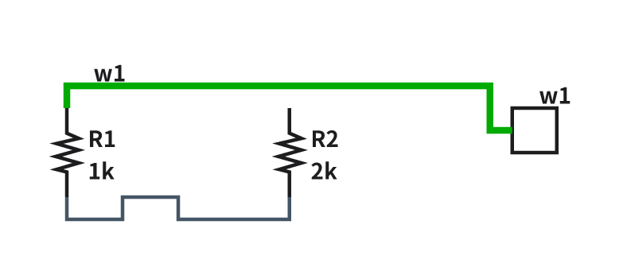
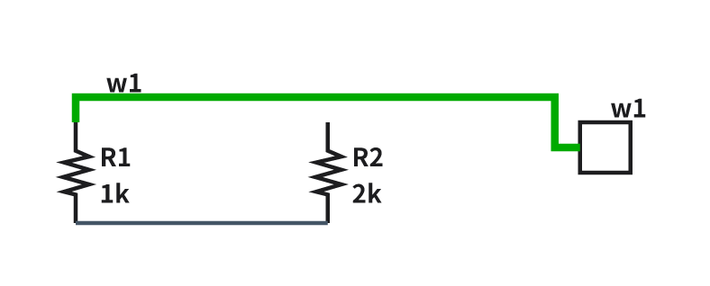
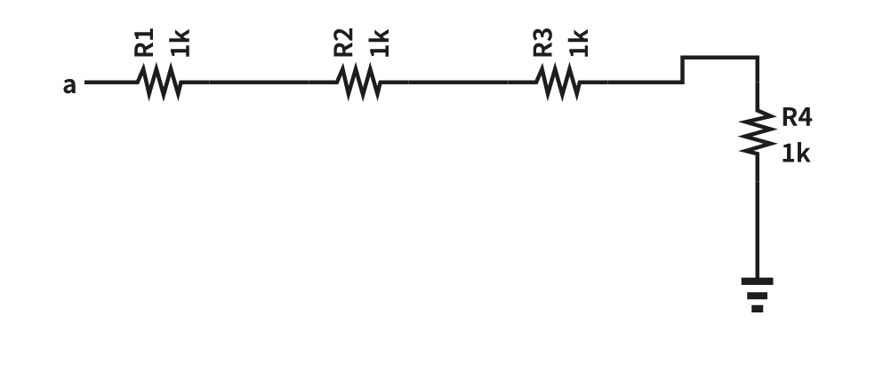
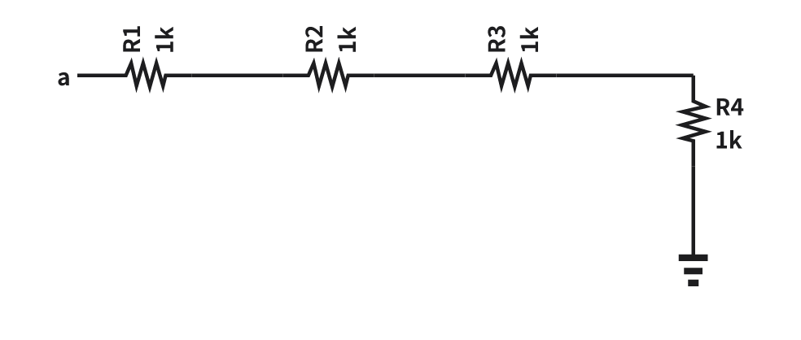

# rnl-runtime

RNL 0.4 has no implicit standard package (16.3): a file names the standard collection `rnl-std-all`, or some of its packages, with USE-PACKAGE, or a tool sets `Options::include_std` to add `rnl-std-all` at the root of the main file when its header record writes no USE-PACKAGE of that name. The setting defaults to false. `Options::std` set to false disables the setting, but not the packages a file names. `Interpretation::included_standard` identifies the version supplied by the setting so writers can persist it in the main header. Missing names still fail individually; an available standard collection is inspected without executing its unused bodies to give at most one missing-package hint per source file. The collection has a header record for each host language, so that a SPICE section finds its symbols by the rules of `rnl-std-spice` and a Spectre section by those of `rnl-std-spectre` (2.8, 16.3).

A bundle's terminals follow the first member's terminal names. Each terminal reaches the terminal with that name in every member, even when its index differs; a member without that name contributes nothing. Unnamed terminals keep their electrical number. Net references, pin connections and net attributes use the same correspondence. When all contributing terminals share a net, the reference and attribute give that one net. Differences in model or subcircuit name, or in terminal count, names or order, give a warning; differences only in parameters do not (11.8).

The language core of RNL 0.4, the language standard in [`spec/`](../../spec/README.md), which reads no other version of the language (16.1); the section numbers in this file are those of the standard 0.4. It takes a host document that a host adapter read (levels, instances, nets, and the records cut out of comment carriers) and returns an interpretation: the diagnostics and the effective model of every drawing level.

| Module | Content |
| --- | --- |
| `records` | Cutting records out of carrier lines: entries, braces, strings, the disabling `/* */` (2.3–2.5). |
| `syntax` | The record parser and its syntax tree. |
| `words` | The standard word list, read from [`data/words.json`](data/words.json), that of the language 0.4: every keyword's signature, kind, attributes and style attributes (5.3). |
| `host` | The host document that adapters fill in. |
| `source` | The `Provider` trait through which the runtime asks for included files and packages, and an in-memory provider. |
| `interp` | Interpretation: headers, aliases, packages, lazy name resolution, definitions, usages, selections, symbol and style queues, geometry facts and their priorities, constraint statuses. |
| `markup` | Text markup and `${…}` attribute paths (13). |
| `model` | The effective model handed to renderers and tools. Each drawn item names the host instances it draws and the nets at its pins, and `Interpretation::refs` lists where the records refer to instances and nets, so a viewer can go from a name to its drawing and back. `Interpretation::failed` lists the statements, or parts of them, that do not take effect: failed with an error (7.2, 7.4), or overridden in a conflict (7.5): dropped in the order of 8.5, or a symbol that loses the appearance queue of every object it is given to (8.3). |
| `problem` | The solver's view of a drawing level, `LevelProblem`, and its hash `sig2` (see below). |
| `numbering` | The check of the numbers of the objects without a name (5.9), SHA-256 included, and `level_check`, what the record of the solver of a level holds (see below). |
| `solution` | A solver's result, `Solution`, written as the one generated record of a level, `write_record`, which lists what the record cannot hold, and finished with the check of its numbers, `finish_record` (see below). |
| `previous` | The decisions of the record of the solver of a level mapped onto its problem, `Previous`, as hints for a warm start, and the solve status that a front end decides from, `solve_status` (see below). |
| `writeback` | Removing, appending and replacing records in host text while keeping everything else byte for byte. |
| `diag` | Diagnostics with level (error, violation, warning, hint), kind, place and cause; `diag::codes`, the kinds. |

A file is read in the language version it declares, once: a second VERSION in its header record is an error and ignored, and the first stands, as the scan of the package directories takes it for a package file (`interp::unit::SECOND_VERSION`, `scan_language_decl`). The core reads 0.4 alone (16.1; `interp::unit::READ_VERSIONS`). A main file or a package file without a header record is read in the tool's default, 0.4, a main file with a hint, and an included file without one in the version of the file that includes it (16.1; `interp::unit::DEFAULT_VERSION`). A file of any other version is of an unsupported version: none of its RNL is interpreted, its host netlist is still read, and RNL2102 `version-unsupported` is an error at its declaration (16.1). For a file of 0.2 or 0.3 the message says that core 0.5.7 reads the file and that its `rnl upgrade` writes it in 0.4 (`interp::unit::unsupported_version`). T, O, U and Z have terminal names by default (6.12): `p1 n1 p2 n2` for T and O, `a b ref` for U, `d g s` for Z, which the runtime gives by the element letter to the instances, as the adapters give the other defaults.

Without a solver, constraints are checked against the written coordinates and get the status `ok`, `failed`, `needs-solver`, `unsolved`, `dropped` or `disabled`; nothing is placed by the runtime. Before that, each constraint is checked on its own (8.5, 9.5): one that has no solution on its own fails with an error at its statement, in a definition body with its application as the origin, and takes no part in the resolution nor in a solver's problem, while the rest of its statement and of its usage stays. The check reads only what is written, so it never fails a constraint that has a solution: an ORDER with two members at one place (a member written twice, an object and its `::position`, a set and its centre); a DISTANCE whose sides overlap whatever the positions (a member on both, or a centre on one side and the points it is the centre of on the other) and whose `min` is above 0, or that measures a place from itself and whose bounds leave 0 out; an ORIENT-RELATION with an object on both sides and a relation other than `"R0"`. ALIGN and DISTRIBUTE always have a solution on their own, as PLACE, ORIENT and the offsets of TEXT do; what a symbol's pins tie together, such as two terminals of one instance, is not looked at. A wire some of whose points have no position yet, such as a free point or the pin of an instance not placed, is not dropped: the model draws its runs of consecutive points that have one, each run of two points or more a `WireView` of the wire, with its id, nets, mode and style, and a flyline in `flylines` from the end of each run to the start of the next. A wire with no point that has a position draws nothing. A text whose position nothing fixes goes where this implementation puts it (13.3), and is drawn whenever what it is attached to is: above the middle of what is drawn of a wire, flylines included; on a net, at the start of its first wire that is drawn, else at its first pin that is drawn; beside the first point of a graphic. That place is the viewer's only: constraints and the solver's view see the text without a position. Two coordinates within `Options::tolerance`, 1e-6 by default, count as equal (11.7).

The hint of a fact discarded in a conflict names every set of facts taken in that has no solution together with it, each fact by the place of the statement that wrote it and its origin, and each statement in these sets gets a hint that names the facts discarded because of it (8.5). Of the facts of one object on one axis, or of its orientation, the runtime keeps the first in the order of 8.5 and takes in with it those that agree with it within the tolerance; each of the others is discarded, and its sets are the kept facts that contradict it, one fact each. Sets that go through constraints would take a solver and are not looked for. A constraint is discarded, as before, when the written coordinates (orientations, for ORIENT-RELATION) violate it and all come before it in the order of 8.5; its sets are the smallest sets of the kept facts that fix its members on its axis and leave it no solution while the members they do not fix are free, searched up to a limit, past which its hint says that the list may not be complete. Discarding a `"low"` fact gives no hint (7.6).

## Packages

Package versions are two unsigned decimal integers, with no machine-integer limit. Invalid declarations or references fail before lookup; an existing `path=` without a valid package declaration fails without falling back to another file. The first PACKAGE declaration stands and later declarations are errors. Numeric spellings with leading zeroes share a package cache identity. `interp::catalog::package_version_key` provides the same version order to catalogs (16.2).

A USE-PACKAGE finds a package by `path=`, relative to the file that writes it, or by its name and version in the package directories of the `Provider` (16.2). The header record of a package file may reference other packages with USE-PACKAGE, a `path=` there relative to the package file. A reference has no body; USE-PACKAGE in a package's other records, and in an inline package, is an error.

- **What a package brings in.** Used, a package brings in what it references first, in the order written and each expanded the same way, then itself; within one USE-PACKAGE each package is placed once, at its first place. Its statements take the position of that USE-PACKAGE, in the order of what it brings in (`unit::Place`), so the rules of a package collection keep their order.
- **One of each name.** On a chain of levels one package of a name is in effect: the USE-PACKAGE written in a file nearest to the level, one in a header record counting as written at the start of its file level, also where packages reference that name. A package that only references bring in takes the newest version within the major version of the reference expanded first, with a hint when the versions differ; a reference of another major version fails, and so does a reference that closes a cycle. A package that is dropped, with an empty inline package of its name, or replaced brings nothing in. A USE-PACKAGE that names no version takes the newest version found, with a hint, and of its copies in several package directories the one of the first directory, as one that names the version does (16.2); of the versions found, those written in the language version the tool reads, 0.4, come first. A file of 0.4 uses only packages of 0.4: a package file that declares another language version is an error at the USE-PACKAGE that reaches it, directly or through other packages (16.1).
- **Names.** A name in a package is looked up in its own definitions, then in the packages it references, the later first and each before what it references, then in the standard package in effect where the package is used; the standard package and what it references see only themselves. The `$` names of the packages a package references are passed on to its users; `%` names stay private. When a name a package uses is in a package one of its references found, but that one is not in effect, the error says so.
- **Diagnostics.** The hint about versions and the warning about a USE-PACKAGE written in a file whose major version a reference does not ask for are reported at the USE-PACKAGE in the file; the error of a failing reference at the reference, with that USE-PACKAGE as its origin. That referenced packages define the same `$` name, or the package itself does, is a hint in the package, shown when the package file is checked on its own (`check_package`, which brings in its references too), as the warnings and hints of a package are (7.6).

The standard package `rnl-std-all` is a package collection of the packages of the standard series (16.3); see [`libraries/standard`](../../libraries/standard/README.md). It comes in through a reference or the tool setting described above. A header reference to it is placed first at the root, while a nearer reference still determines its version. `LevelView::packages` lists the packages in effect at each drawing level, with their versions, their places and the USE-PACKAGE written in a file that brings each in.

`interp::catalog::package_contents` reads a package file as `check_package` checks it, on its own (2.7), and gives what it defines: its name, version, language version and references; its own symbols, each as the model gives the symbols it draws (`SymbolView`: the box it writes or the extent of its graphics, its pins), with the terminals of its pins as written and its labels, the texts it writes with a key (13.3); its ordinary definitions, with their roles as `roles=` writes them and their parameters; its sets; and its rules written `# @SELECT-USAGE $DEF => @SET-SYMBOL $SYM`, each name with the package that defines it, found as the rule finds it (16.2). The catalog of [`rnl-view`](../rnl-view/README.md#catalog) lists them.

- **Which standard package** (16.3). The setting `Options::include_std` adds one reference at the root of the main file, and none when the header record of the main file writes a USE-PACKAGE of `rnl-std-all` in any form, which stands instead. The reference is to the newest version in the package directories of the standard series written in the language version of the file, 0.4, as the header record of the series' `rnl-std-all` declares it, or to the version that the reading asks for (`Options::std_version`) (`packages::Interp::std_package`). Of the files of one version, the one found is the first in the order of the package directories, as for any package (16.2): a frontend's own `rnl-std-all` of a version hides the bundled one. A standard package written in another language version, or an alias package, is not used (16.1, 16.5). A version pinned with USE-PACKAGE in the header record of the file, or of a file that includes it, comes first and stands in the place of the one the setting adds at the root, so that the packages at the root are in the order of the series in effect; an inline package of its name, which drops or freezes it, leaves the place as it is. A version that the reading asks for and that cannot be found is an error once, on the first chain that would use it (`packages::Interp::tell_missing_std`): a chain where a header record pins a version, or an inline package of its name drops or freezes it, does not need it. A package checked on its own gets the one the setting adds when it is the main file of the reading, and none when it is not read, such as a package of a version that the toolkit does not read.

- **The rule packages of the two dialects** (2.8, 16.3). The standard series 0.4 has its rules for instances in two packages, `rnl-std-spice` and `rnl-std-spectre`, and its collection `rnl-std-all` has a header record without `language` for what both host languages share, one with `language="spice"` that uses `rnl-std-spice`, and one with `language="spectre"` that uses `rnl-std-spectre`. A header record with `language` acts only on the host sections of its language (see the records with `language` below), so a SPICE section of a Spectre file finds its symbols by the rules of SPICE and the Spectre sections by those of Spectre.

## Selection reach

Selections default to `recursive=false`. A statement that writes a selection, including one inside a set literal, reaches lower levels only when one of its written selections has `recursive=true`. A named set used by that statement does not extend its reach. Without a written selection, a rule reaches the levels reached by its selection-dependent inputs.

Set reach follows its binding, members and ADD-TO sources; REMOVE-FROM does not extend it. An ADD-TO statement without a written selection follows its source, not its target. A local set is empty outside its reach, including when a recursive rule uses it. Selection edits written after a use are included when deciding whether the use is a rule. Each evaluation still contains objects of only one drawing level.

For an explicit selection scope, each member contributes its results in turn, with duplicates removed at their first occurrence (10.3). In particular, `{&b &a} @SELECT-WIRE` gives the wires on `b` before the remaining wires on `a`; labels follow their scoped owners, and ancestor usages follow the scoped members. Repeated or overlapping net and annotation scopes also produce each result once.

An ordinary definition can have `roles=[]`. In its body, bare `#` is the usage's drawing level, whether or not the definition has roles. Body rules start in that level and follow the same reach rules. Inheriting a body rule does not create another copy of its enclosing usage, and each usage keeps its own role and local bindings. A role referring to a parent-level object is empty when used as a selection scope below that level; another single role of a generation cannot carry that object into a lower level. Collection roles keep only that level's members, including when their members are pins.

Named host references still enter through roles, and symbol bodies cannot use bare `#`. An ordinary definition body cannot assign its level's block symbol: `# @SET-SYMBOL $S` reports RNL3416, including when the definition is never applied.

A definition receiving a selection-dependent set role is a generation rule, applied once with the whole set. A single-object role still expands one member at a time, including repeated members of an ordinary set.

Package rules start at their USE-PACKAGE level, with root packages starting at the top level of the file that uses them. A scoped record starts at its target level.

## Reading one file of a document

`Options::only_file` names a file of the document, as `Level::file` names it, and builds only the levels written in it: the subcircuits it defines and, for the main file, the main file level. The rest is read as for the whole document: every file and its records, the packages, the block symbols of the subcircuits (9.2.6) and the files above it (6.1), whose circuits are built too for the rules they hold that reach below (10.1) and are not given. So each level it gives is the one the reading of the whole document gives, with the same drawing, problem, numbers (5.9) and references, which `per_file::differences` checks. What it reports is among what the whole reading reports: what reading the document reports (`Interpretation::read`, the diagnostics before any level is built), what building its levels and the levels above them reports, and the checks of its own levels (6.8, 16.2, 2.6); `per_file::unreported` says what no reading of one file reports. The objects of a reading are numbered in it, so the identity of a symbol and the id `@N` of an object with no name and no place of its own are those of the reading. `rnl dump --file F` prints such a reading, `rnl view --file F` the reading a viewer gets of it (`rnl_view::build_file`), and `rnl dump --each-file` compares the reading of each file with the whole. Such a reading also gives `Interpretation::block_symbols`, the symbols the subcircuits of the files it instantiates give themselves; with `Options::symbols_only` it builds no level and gives those of the file's own subcircuits.

## For a solver

`Options::read_options` gives what of the options a reading takes, `ReadOptions`: every option but the tool's settings for the solver (`Options::solver_config`), of which it keeps those of `junction` (13.2), the only ones a reading takes. The interpreter is made from `ReadOptions` alone, so an option reaches a reading only through it. `Options::reads_as` says whether two options read a document alike: whether their `ReadOptions` are equal. A tool that read the document already takes that reading instead of reading again with such options, as `rnl_view::build_taking` does.

A solver must not read the records with `type="generated"` (2.8). `Options::generated` set to false leaves them out of every file of the document, with whatever they would report; `Options::solver()` does that and sets `Options::problems`, so that `Interpretation::problems` holds one `LevelProblem` per drawing level:

- the objects that have or need a position, in a fixed order: instances and bundles, virtual parts (one drawn on the point of its main object has only its orientation), points (free ones too) and texts. A text that its owner's symbol places moves with the owner (`Position::InSymbol`); a PLACE or an offset in the scene replaces that position axis by axis, whichever is written later (13.3), so on the axis replaced, `replaced`, the text has its own coordinate, and the symbol gives only the other; a text replaced on both axes has a position of its own. Each has x and y fixed by a fact or free, its orientation fixed or free, its symbol (box, pins with their directions and terminals), and how the level's text refers to it for write-back: `#M1`, `%g0`, `#M1::name`, `%dp::mid`, through the usage a rule made (10.5), by its number (`Reference::Number`, see below), by the number it takes in the record that writes out the usage a rule made when no name of that usage reaches it (`Reference::GeneratedNumber`, see below), or not at all (5.7);
- the geometric facts in the order of 8.5, `"disabled"` ones left out: PLACE coordinates, the coordinates written in points, TEXT `dx` and `dy`, ORIENT, ALIGN, ORDER, DISTRIBUTE, DISTANCE and ORIENT-RELATION, each with its members as points (an origin, a pin, the centre or the extent of a set), its parameters, effective priority, source and the usages it was expanded from. The index of a fact is its rank;
- the nets (`LevelProblem::nets`, 6.3), in the order the netlist first names them, the ports of a subcircuit first: each with its name, its reference `&name`, every pin on it (each terminal with a pin of an instance, a bundle or a virtual part, those of `$GND`, `$SUPPLY` and `$IOPORT` included, the pin of a bus on each net of its members, in the order of the objects and then of the pins), the wires that draw it, the ROUTEs that ask for it and its place among the ports; and for each virtual part and text the nets it is on (`ProblemObject::nets`): of its terminals, or of the net, the wire or the terminal it is attached to;
- the wires with their anchors and modes, as the authored records rewrite them (see below), the ROUTEs with the pins to join, the groups (without those PRIORITY turns off: a set with GROUP takes PRIORITY as the group itself, 14.8), every usage with its definition, roles and the place of its AS or ATTACH (`UsageEntry::source`, left out of the hash like every place), the packages in effect and the level's `%` names, those that the records written into it with `scope=` bind among them (2.6, 6.7).

In the order of 8.5, of the segments of one pipe the later comes first, before what a segment adds, such as its members or the axes of a PLACE: the facts of `#R1 @PLACE(0, 0) => @PLACE(5, 5)` come as y = 5, x = 5, y = 0, x = 0, and in `#M1 @PLACE(0, 0) => @ORIENT("R90")` the ORIENT comes first, as 5.5 and 8.5 say; a viewer keeps the same one of two coordinates or orientations of an object. A later segment is written later wherever the place of writing matters: in the appearance and style queues, for LAYER, PRIORITY and CURRENT, in the drawing order, for bundles, the rewrites of a wire and the edits of a set. So do the rule of 13.3, between the PLACE of a text and its offset and between the TEXTs written on one key, and the check of cycles of sets (5.2.2), whose statement last in order of position fails.

### Writing back

The solver writes back every decision (14.8): a decision that is not in its record is not a result, and its object stays free, as if the level were not solved, which is how a viewer that does not solve shows it.

The interface is RNL: a result that a solver passes to another tool, such as a solution that a viewer shows, holds only what a record of the solver can hold, so that every result can be saved as one. `solution::Solution` is made so: the positions and orientations of the objects of the problem (`Placement`, a coordinate on each axis that the solver decides, `x` and `y`, both or one alone, and the orientation), the routes of the `"auto"` wires written in RNL, through their points and coordinates (`WireRoute`, 13.1), the wires routed for ROUTE (`RoutedWire`, 13.7), and their branch points and junctions (`Branch`).

`solution::write_record(problem, solution, author, hash)` writes the record the solver writes at the end of the level's own text, `@RNL(type="generated", priority="high", author="…", hash="…") {…}`, coordinates by `geom::fmt_num`:

- first the usages that rules made which the result reaches, written out as explicit statements under names that stay from one solve to the next, such as `%gnd_stub_M1_s = $GND_STUB @ATTACH(gap=2) #M1:s`, so that `%gnd_stub_M1_s::g @PLACE(…)` places the ground, with the priority that its rule wrote on it, as written, or the `"disabled"` of the record its rule is written in, and with none otherwise, since the record's `"high"` does not reach it, so that its body keeps its priorities (14.8); then the branch points as named points, the positions and orientations, the wires routed for ROUTE as new WIREs with `mode="straight"` and the style of their ROUTE, the routes of the wires, and the junctions;
- an object by its name or key; one without a name by its number, `%#3`, `%#5::mid`, `%#1:p`; one without a name in the body of a usage a rule made by the number it takes among the record's own objects: after those of the authored records (`LevelProblem::authored_numbers`) and of the usages written out before its usage, its place among the objects that the statement writing out its usage makes (`Reference::GeneratedNumber`, `UsageEntry::written_numbers`), as for the wire of a `$GND_STUB`;
- the route of a wire as WIRE given the wire, such as `%#2 @WIRE(mode="straight") {#M1:d (12, 2) %#3 (12, 6) #R1:n}` or `%w @WIRE(mode="straight") {…}`. A solver should keep the points of the wire in order and add only bends between them (13.1): `Written::notes` notes a route that does not, and one of a wire that is not `"auto"`, and both are written as given;
- a position on the axes the `Placement` gives: `@PLACE(x, y)`, or `@PLACE(x=…)` or `@PLACE(y=…)` for one alone (11.1);
- a text that the file places on an axis by what it is attached to, by an offset or as its owner's symbol does on an axis that the scene does not replace, keeps that where the solution has it there (within `geom::TOL`): its position is written on its other axis only, `@PLACE(x=…)` or `@PLACE(y=…)`, or not at all, since a PLACE written after would replace it and the text would no longer follow what it is attached to (13.3). Where the solution has it elsewhere on such an axis, as when the solver discarded the offset (8.5), the PLACE is written on that axis, and replaces the offset there (13.3).

`Written::unsolved` lists every decision of the solution that the record does not hold, with the reason, a position on the axis it is given on when it is given on one alone (`Decision::Position { axis }`, "the x of …"), and nothing else is left out; an axis that a `Placement` does not give is no decision, and not unsolved; but what the file fixes: a position or an orientation that the record cannot hold is not unsolved when it is what the facts of the file give the object, the coordinates of its PLACEs or of its point (11.1) and the orientation of its ORIENT (11.2), within `geom::TOL`, since a viewer that does not solve draws it there all the same. An object the record reaches has them written all the same, so that they rank with the record's priority (14.8). The others are the position of a text without a key that a rule makes, which nothing can refer to, so the solver does not decide it and the viewer places it (13.3); an object reached through nothing (5.7), or through a usage made by a rule that cannot be written out (10.5); in a problem read with the records of the solver, which a solver does not read (2.8), an object that one of them makes, since the record replaces them; a position given to an object drawn at the point of its main object (12.1), an orientation given to a point or a text (11.2); a wire with fewer than two points or through the centre of a set; a coordinate that is NaN or infinite, which RNL cannot write (3.7); an index that is not in the problem or the solution.

`solution::finish_record(doc, files, options, problem, record)` gives a record that uses a number `numbering`, the check of its numbers (5.9); a record that uses none needs none and stays as it is. The check covers the objects of the authored records and the record's own: the coordinates in its wires, the bodies of the usages it writes out, its junctions. So the document is read again, with the record in place of the level's records of the solver, and the check is `numbering::level_check` of the level. `doc` is the host document that the problem was read from (`Interpretation::doc`), and `files` and `options` are what it was read with, packages included: `rnl_view::finish_record` layers the bundled packages under the files, as `rnl_view::interpret` does. `writeback::replace_generated_with_header` then puts the record in place of the level's previous one and gives the file its header, in one pass.

`writeback::replace_records(doc, level, text, records, reread)` replaces the records of one level by the records it is given, which are RNL source without comment markers, the level's whole new drawing: the records written in the level's own text go, authored or `type="generated"` but for a header record, with the records of the solver written for it with scope= above it in the same file, and the new ones are written at the end of its own text where `record_line` puts a record, in the comment marker and line endings of the file, so that no other byte of the file changes. It refuses with a `writeback::Refused`, a kind of the list (RNL8403 to RNL8411) and its reason, and gives no text, where `writeback::find_level` finds no level of the title or several, the level has no place for a record, the records would come before the header record of the file, or they do not read: `reread` is given the new text and gives the document read again, the file declares a version that is not interpreted (16.1), an error lies in the new lines or the records read back otherwise than given all refuse. `rnl_edit::replace::replace_records` supplies the reading from a provider of files.

`writeback::replace_generated(doc, level, text, record)` removes the records of the solver that apply to the level (`writeback::generated_for`): those written in its text and, although a solver does not write scope= (2.6), those written for it with scope= in a level above it; one in another file is removed from that file by `writeback::remove_generated_for`, and `writeback::generated_files` says which files hold them. Tokens left after a record removed from their line, which fail there (2.4), keep an empty record before them, `@RNL {}`, so that they still do.

A tool that saves a file gives it its header record and version (16.1): `@RNL(type="header") { @VERSION("…")}` on the line after the first line, which never carries RNL, or VERSION in a header record that has none; nothing when the file has both. Spectre reads a file that is not a `.scs` file in SPICE mode up to its `simulator lang=spectre`, where `//` is no comment (2.2): a header in `//` goes after that statement when only comments that hold no record come before it, and otherwise above it, written with `*`, which carries in both modes, as the record written with it then is. A file read only through library sections (`.lib file sec`, `include "file" section=sec`, `Level::section`) gets no new header, since its line 2 lies outside them and is not read (2.2); a header that the reading found inside a section gets its version there. Every change is made at the positions of the document's reading of the text, so a solver makes both in one pass: `writeback::replace_generated_with_header(doc, level, text, record, version)` for the file of the level it solved, and `writeback::remove_generated_with_header(doc, level, file, text, version)` for a file that holds a record of the solver written for the level with scope=. The header record stays the first record of its file (2.8): one written after a subcircuit, which the record put at the end of the subcircuit would come before, moves where a new header goes (2.2, 2.8), on line 2 after the title, or after the `simulator lang=spectre` that is the first statement of a file in `//`, and otherwise above it in `*`, with its version and the indentation of its lines; in a file read only through library sections, whose line 2 is not read, it moves above the subcircuit instead, the outermost one in the file that holds the level. A solver that writes several levels of a file moves such a header before it writes the first of them, with `writeback::move_header_for(doc, level, text, version)`, and reads the file again: where the header goes it may need `*`, and the records of the levels written before the one that moves it then follow it in `*` too, as the next solve, which finds it there, writes them. A record removed leaves no line that holds only its marker, the file's carrier or the other one of a Spectre file, `*` or `//`. One that is not the first record as the file is read is left as it is, an error its author fixes. `writeback::with_header(doc, file, text, version)` alone is right only on the text the document was read from: after `replace_generated` the positions of that reading no longer describe the text.

Nothing is written where a reading loses it (2.2). A record goes at the end of its level's own text, but when that end lies in a region written to be encrypted (`.prot … .unprot`, `protect … unprotect`, `HostDocument::protected`), where a record is gone once the region is encrypted, it goes before the region, and before the subcircuit of the level that holds that place: `writeback::record_line(doc, level, text)` gives the line, or the region when the level has no such place, as a subcircuit whose `.subckt` lies in one has none, and the functions that write leave such a level and its file as they are. The records of the solver that a new one replaces are removed wherever they are. A header record in such a region gets no VERSION, and one that moves above a subcircuit whose `.subckt` lies in one goes before the region. A record is carried by the marker of its file, but by `*` where the reading is in SPICE mode (`HostDocument::spice_mode`, `writeback::carrier_at`), such as a `simulator lang=spice` section of a Spectre file, where `//` is no comment.

A tool writes only 0.4: the header record it gives a file declares 0.4, and a file of a version that is not read is kept as it is (16.1). A library section read is a file of its own (2.8), a file level with its header record and its version (`HostDocument::file_level`, `file_level_at`, and for an instance `file_level_of`, by `Instance::file_level`, the include or section the adapter read it through, so that a file or section read twice is two file levels). `writeback::with_standard_package(doc, text, version)` writes into the header record of the main file the USE-PACKAGE of the standard package that `Options::include_std` added, with the version of `Interpretation::included_standard`, so that the file is drawn the same by any tool (16.3).

### The default route of `auto`

`geom::auto::auto_wire` draws an `auto` wire that has no route of a solver, and the
solver calls it for the same path (13.1). An end that is a pin with a direction, after the
orientation of its object, is directed: the wire leaves it along that direction or at a right
angle to it, and arrives at it against that direction or at a right angle to it, never the other
way; a right angle at an end counts as a bend. Of these routes it takes the one with the fewest
bends; then the shortest, a leg that goes out only to come back being 1 long; then the one that
turns at fewer directed ends, keeping the direction of the first end before that of the last;
then the one whose middle leg lies halfway between the ends; between two undirected ends, the one
that goes horizontally first; and a detour goes to the left of the first directed end. Its bends
keep their exact values and may fall on half units.

| Before: out of each pin first | After: a right angle at the pin |
| --- | --- |
|  |  |
|  |  |

### WIRE given a wire

The net slot of WIRE takes a net, a set of nets or one wire (13.1). Given a wire, WIRE makes no new wire: the statement is read as a new WIRE would be, and its list of points and its mode, `"auto"` when not written, replace the wire's; the net of the wire stays. Its style parameters are direct style of the wire, as if a SET-STYLE were written for the wire at the statement (8.3), also when a later rewrite replaces this one, but not when it fails; the handle it passes on is the wire.

The rewrite has a key, the wire: of several, the one written last by position takes effect, and in one pipe the later segment (8.4). It is no geometric fact (8.5). A rewrite that fails is an error and has no effect, its style parameters included, and the wire keeps its earlier list and mode, those of the latest rewrite that holds or those it was made with (5.8): when it is read, such as one with a single point, or once the symbols are known, as one that lists a terminal without a pin (9.2.4), of a usage without a symbol (12.1) or of an instance in a bundle (11.8). The wire does not fail then; it fails, as before, only when the list it was made with fails and no rewrite holds. A rewrite that fails is an error also when a later one holds. The model, the solver's view, the checks of the terminals a wire reaches and `wired=` (10.2) read the wire as rewritten. A solver reads the level without the records of the solver, so it sees the rewrites of the authored records, such as an editor's, and not its own. A set that holds a wire is of the wrong kind.

### The hash

`problem::sig2(problem, solver_options)` is the `hash` of the record head (17): `sig2:` and two digests of 16 hexadecimal digits joined by `.`, such as `sig2:ff3359ad9a333ccc.44669707c032ab3e`. `sig2` is the `sig1` that tools wrote before, with the nets of the level (`LevelProblem::nets`, `ProblemObject::nets`), so that connecting a terminal elsewhere changes it. A `sig1` hash is only read, never written: `problem::same_input` compares it over what it covers, the problem without its nets (`problem::input_digest_sig1`, `problem::canonical_sig1`), so that a record written before reads as it did, up to date until its input changes.

- The first digest is of the solver's input: a canonical text of the `LevelProblem`, which already holds the level after inheritance (the rules that flow down and take effect, the symbols chosen, the packages and their versions), built without the generated records; metadata never reaches it. Where things are written (files, lines, columns, the index of the level) is left out, so white space and comments do not change it. It is 64-bit FNV-1a over the UTF-8 text, numbers written by `fmt_num`, so it is the same on every platform. `problem::input_digest` gives it alone.
- The second digest is of the solver's options as one string, the tolerance included, such as `tolerance=0.000001`: `problem::options_digest`.

A viewer has no solver and does not know its options, so it compares only the first segment: `problem::same_input(hash, &problem)` is `Some(true)` when the input is unchanged, `Some(false)` when the solution is stale, and `None` for a hash of another algorithm, which a tool does not compare (17). The problem it compares with is built as the solver builds it, with `Options::solver()`. The numbers of the objects without a name are left out of it, the object counting as one without a reference: they follow from the text, which the check below covers.

### Numbers of the objects without a name

The record of the solver refers by number to the objects that no name reaches, so that it can write back every decision (5.9). The runtime numbers them in every drawing level: `Reference::Number { number, path }`, with `path` such as `["::mid"]` for a local object of a usage that has a number, or `[":p"]` for one of its terminals.

- **What is numbered**: the points, wires, texts without a key, bundles, graphics in the scene and usages that the statements of the level's own records make, also in the bodies of the usages these make, and that have no name of their own: a name that the member of the record, or of the body, making the object binds to it (`%x = …`, `… => %x`, a local name in a body). A name bound only inside a `{…}` holds only there (6.7) and does not count. What `::` reaches (local objects, texts with a key) is never numbered, nor are constraints, sets and what rules make (10.5).
- **Order**: first the authored records, the level's own text and then the records written into it with `scope=`, in the order of 2.6; then one record of the solver (`type="generated"`, in the level's own text). In a record, by the token that makes the object, in the order of the text, not of evaluation: the `(` of a point, the keyword of the others. One token that makes an object for each member of a set gives each its own number, in the order of the members. An unnamed usage made by AS or ATTACH comes first and the objects of its body right after it, in the order of the body, depth first; a named usage has no number, but the objects of its body do, at its place. Numbers start at 1. The objects of the authored records are counted as the level reads without its records of the solver, as a solver reads it, and keep their numbers when it is read with them: a reading with a record of the solver first reads the document without those records, and gives each object the number of the one made there in the same way, by the statement, the token and the member of a set; an object that only the reading with them makes, such as a label on a member that a record of the solver adds to a set, has none. A problem built without the generated records (`Options::solver()`) has the numbers of the authored records only; one built with them numbers each record of the solver's own objects after those.
- **Reading `%#3`**: the parser takes `%#` and digits as a reference, which works like a name (`%#5:p`, `%#5::mid`, `%#5::name`). A number is resolved only in a statement of a record with `type="generated"` in the level's own text; anywhere else, in a definition body too, it is an error. `numbering`, the check, is a field of the record head (2.8): 16 hexadecimal digits, only with `type="generated"`; otherwise it is an error and treated as not written. The record's own objects are counted on the record as written, every number in it read, so a number may be used before the member that makes its object, as a name may (6.7): when that member is still being read, the document is read again with the objects counted the first time. A number beyond them is an error.
- **The check**: one line for each number, in order: the tokens of the statement that makes the object (the member of the record, or of the body, between `;`, pipes included), without free text and comments, each as written, separated by one space; for an object in the body of a usage, the line of the usage first, made the same way whether the usage has a number or not, then a tab and the statement of the body as the definition writes it, the outermost usage first; when the statement makes an object for each member of a set, a tab and the member as a reference: `#M1`, `&out`, a terminal by its owner and its number (`#M1:1`), an RNL object by its name or its number (`%x`, `%#3`), a position or a text with a key through `::`. A reference is one token with its path and its subscript, the white space and comments inside the subscript left out (`&D<7:0>`); in the brackets of points, parameters and roles, and in arrays, each bracket, `,`, `=`, string (in its quotes, as written), number (as written), name, `_` and placeholder is a token, so the example of 5.9 gives `&out @WIRE { #M1:1 ( _ , _ ) #R1:2 }`. The check is the first 16 hexadecimal digits, in lower case, of the SHA-256 of the lines in UTF-8, each ended by a line feed: `numbering::check`.
- **When a file is read**, the check of each record of the solver (the authored records' lines, then the record's own) is compared with its `numbering`, as hexadecimal digits in either case. When it matches, the numbers resolve. When it does not, every statement of the record that uses a number takes no effect, as if it were not written, with no error and no failed statement, and the record gives one hint that it is out of date for the objects without a name; its other statements take effect as usual. A record that uses numbers without `numbering` has them as errors. A record that uses no number need not have `numbering`, and one that does not match changes nothing and gives no hint. Both are known only once every level is read, so the document is then read once more.
- **For the writer**: `Interpretation::numbering` gives each drawn level its lines and checks, and `numbering::level_check(&interpretation, level)` the check that the record of the solver of the level holds: that of its last record of the solver, or of the authored records alone when it has none. It is the check of the text as written, every number read, even when the record's own `numbering` does not match or is missing. So a writer puts its record in the level, reads the level again, and puts `level_check` in the record head when the record uses a number, which is what `solution::finish_record` does (see above).

### The previous result, and the solve status

A solver reads a level without its records of the solver, and how else it uses them is up to it (2.8). `previous::previous(&problem, &with)` gives it the decisions of the level's record of the solver, mapped onto its problem, as hints for a warm start: a `Previous`, or none when the level has no record of the solver, which is its last record with `type="generated"` in its own text, without `scope=`. `with` is the same document read with the records of the solver and with `Options::problems`: the reading a viewer shows, with the problems built as well, so a viewer reads nothing twice for it. `previous::read_previous(doc, files, options, sink)` makes both readings, for a solver that starts from the files, and reads a document without records of the solver once; `rnl_view::read_previous` does the same for an entry, with the bundled packages, and `rnl problem --previous` prints it. A `Previous` holds:

- `hash` as written; `same_input`, whether its input digest is the problem's (`problem::same_input`), none for a hash that is neither `sig2` nor `sig1`; and `numbering`, whether its numbers hold, none when it uses no number (5.9);
- `placements`: each object of the problem that the record places or turns, as a `solution::Placement`, with the coordinates the record gives, on both axes or on one alone (`@PLACE(x=…)`, or the axis of a text that its owner's symbol or an offset places on the other);
- `wire_routes`: each wire of the problem that the record rewrites with WIRE given the wire (13.1), with its route as drawn: its points in the scene, the pins and points it passes and the bends between them;
- `wires`: the wires that the record writes itself, as a solver does for ROUTE (13.7), with their nets and their points as drawn.

The mapping goes by the reference that each object and wire of the problem has: a name as written; a number of the authored records, which is the same with and without the records of the solver (5.9); through a usage that a rule makes, the name that `solution::generated_names` gives it, which the record writes it out under; and for an object without a name in the body of such a usage (`Reference::GeneratedNumber`), its place among the objects of the body that the record writes out. What maps to nothing is left out, such as a usage the record writes out under another name, and so is what takes no effect: the statements that use a number, when the record's `numbering` is out of date.

`previous::solve_status(&problem, &view, &with)` is what a front end decides from whether to solve a level (decision 0008). `problem` and `view` are the level's problem and model read without the records of the solver, and `with` is the reading with them:

- `fixed`: no record of the solver, and nothing for a solver to decide (`previous::is_fixed`): no object of the problem that can be referred to has a free coordinate or a free orientation (`Slot::Free`, `OrientSlot::Free`), its own or, for a text that its owner's symbol places, the one on the axis that the scene replaces (`replaced`, 13.3), no wire that can be referred to is `"auto"`, the level has no ROUTE, and no constraint has the status `needs-solver`. An object that nothing can refer to (`Reference::Anonymous`), such as a text without a key that a rule makes, is not the solver's to decide (14.8): the viewer places it (13.3); nor is a text attached to what has no coordinate point, a wire, a net, a graphic, a usage without a symbol or a terminal without a pin, that no fact reaches, which a solver leaves free and the viewer places next to what it is attached to (13.3);
- `unsolved`: no record of the solver, and something to decide;
- `solved`: a record of the solver whose `hash` has the input digest of the level now, or is neither a `sig2` nor a `sig1` hash, which is not compared (17), and whose numbers hold when it uses numbers;
- `stale`: a record of the solver whose `hash` is of another input, or that uses numbers with a `numbering` that is missing or out of date.

A level with a record of the solver is solved or stale, whatever it leaves to decide: a stale record still holds what it decided, and solving again replaces it.

The crate does no file I/O, so it builds for `wasm32-unknown-unknown`. Diagnostic messages are in English; the language fixes which item fails and where, not the wording (7.6).

Every diagnostic is of a kind of the toolkit's list, [`data/diagnostics.json`](data/diagnostics.json), `Diag::code`: a number, RNL and four digits, and a short name, such as RNL3120 `param-wrong-type`. Numbers and names are kept from one version to the next and never given to another kind; a kind that the toolkit no longer gives is listed under `retired`, with the last core that gave it, such as RNL8111 `solve-preview-notice`, and its number is given to no other kind; a new one takes the next number of its hundred. The thousands give the domain: 0 to 6 the domains of the standard (the host netlist, the records and their syntax, headers, packages and aliases, names and statements, the geometry, the solver's record), 7 the geometry hints, 8 the tools, 9 the kinds of the implementation of the domains 0 to 6 (9D00, D the domain). `build.rs` makes a constant of each, `diag::codes::PARAM_WRONG_TYPE`; every place that gives a diagnostic names its kind, so a tool or a test tells the kinds apart by code, not by message. `Sink::render` writes a diagnostic as `rnl check` prints it: `error t.sp:3:5: RNL3120 param-wrong-type: …`. The reasons of `solution::Unsolved` have kinds of the list too (RNL82xx).

A violation (7.6) is a statement about the circuit that does not hold: nothing fails, it is reported as an error is, after errors and before warnings, and a document shows it also when it comes from a package it uses. Two sources give them:

- The CURRENT statements of a net that send all its current one way (15.2), RNL6003 `violation-current-one-way`: every terminal on the net, the ports of the level included, has a CURRENT of `in` or `out`, and all of them move current into the net, or all out of it; it is given at the latest of them. A global net, such as `0`, is not checked.
- The assertions ASSERT-INSTANCE, ASSERT-TERMINAL and ASSERT-NET (15.3), in `interp::assertions`, checked after the geometry phase: a condition a member does not meet (RNL6000), an attribute of `same` that differs (RNL6002), one of `different` that two members share (RNL6001), and one of `has` that a member lacks (RNL6004). In the body of a general definition an assertion is checked for each application, and the message names the usage. `symbol=` and `drawn` of ASSERT-INSTANCE are not read yet.
- ASSERT-TOPOLOGY (15.4), in `interp::topology`, checked with them: members that are not in series, in parallel, a star or a single loop as it says (RNL6005). A member is an instance, or a usage or a set taken as a black box, whose nets are those it shares with the rest of the level; `exclude` takes out terminals by type.

The word list (`words`) says which keywords and parameters 0.4 has, which values each parameter takes, and whether it takes a list of them (5.3).

The positional facts write their direction (14.1). ORDER, DISTRIBUTE and DISTANCE take one of the four directions, and `"x"` or `"y"` alone, or DISTRIBUTE's `axis=`, is an error (RNL3122). DISTRIBUTE's members then also follow one another in its direction, as for ORDER: the problem's `FactKind::Distribute` has a `sense`. ORIENT takes a list of codes, and `"left"`, `"down"`, `"right"` and `"up"` as other spellings of the four turns (11.2); ORIENT-RELATION takes a list of relations, and a set of more than one member in both its slots is an error (RNL5003, 14.9). A list is one fact of which one code is to hold: the fact has the first, and `LevelProblem::orient_lists` every code, so that a solver that does not read the lists takes the first. The solver of this repository does so for now.

See the [roadmap](../../docs/roadmap.md) for planned work.

Generation rules can select the labels brought by symbols already assigned before generation. Overriding an existing text key does not create a new label or remove the original handle from that snapshot. Labels of generated usages appear only in later phases.

Generation selections exclude every object made by a generation rule, including graphics inside generated usages. Explicit objects stay in the snapshot, and later geometry and style rules still see the generated objects (10.5).

Scene selections order objects by creation step and source position (10.3), so forward-reference evaluation does not reorder usages and annotations interleave graphics with text. Symbol text ordering follows the owner and then the symbol's statements. Explicit selection scopes retain their own member order.

Spectre `tline` and `transformer` instances have the default terminal names `p1`, `n1`, `p2`, `n2` (6.12). Explicit DEVICE terminal names still override these defaults.

TEXT accepts `fix_rotate=true`: the anchor still follows the symbol, but the text direction stays in scene axes. Keyed TEXT statements override this item independently, including an explicit `false`. `TextInfo.fix_rotate` carries it to the solver; the canonical input adds a marker only when true, leaving older digests unchanged. Fixed symbol text and label templates carry the same setting to renderers.

DEVICE declarations supply terminal names and an optional type independently (6.12). Each needs a name or model pattern and at least one of terminals or type. Later matching declarations replace only the items they write. Header declarations follow the source file of each instance, including host lines read through includes. Duplicate terminal names follow host case rules (package lists ignore case), and all-digit names fail the whole declaration. Types supplied by the host and ports of defined subcircuits take precedence, with a warning for conflicting DEVICE items. Selections, text attributes and assertions read the same effective type.

Graphic rules accept selections: sized rectangles, circles and ellipses draw one graphic per selected point, while LINE, ARC and BEZIER draw through the complete ordered result (9.2.5, 10.4). Their generated set can receive later appearance and position constraints; generation sees the shared snapshot. Two-point closed shapes reject selection inputs.

Records can use `language="spice"` or `language="spectre"` to restrict object statements to host sections (2.8). Ownership follows instances, ports, shared nets and usage roles, independently of coordinates; collection roles use their final members. Cross-section statements and dependents take no effect, while definitions retain their nominal visibility. Qualified headers contain USE-PACKAGE and DEVICE, and their masks intersect along effective package references. Records with no reachable section are not checked; package body checks wait for their effective scope. Unknown values make records inactive with a warning, and generated records reject and ignore the qualifier.

Text and pin labels read formulas inside `\(…\)` (13.6), including single-character scripts, roman groups, fractions and square roots. Variables are italic; digits, symbols and attribute values remain upright even in italic text. `Run::Sqrt` carries its radicand, and `RunStyle::upright` forces that face. The renderer uses the same geometry for drawn formulas and text bounds. Canonical solver input includes the new structure and face only when present.

When the renderer leaves an instance without a symbol undrawn,
its warning explains that drawing statements involving it have no effect (9.2.8).
Positions, orientations and attached text do not reach the drawing or solver;
constraints and wires containing it or its terminals are omitted as a whole.
Such constraints retain their handles and report `status: "ignored"`, rather than
failing. A wire rewrite with such an input leaves the previous effective points,
mode and style in place. Creation-phase selection snapshots are unchanged.
An explicitly assigned symbol that lacks a required pin still produces an error.

Carrier scanning keeps a complete record even when a member leaves
parameter, point, role or list parentheses unclosed: that member fails and reading
continues at the next member (2.4, 7.4). Unclosed strings, comments and record braces
still make the record fail as a whole. Host adapters retain alternative record
boundaries until file versions are known, so includes inherit the right version even
when an include precedes its parent's header. Two readings of one physical file may
use different inherited versions. A file of a version that is not read keeps the
boundaries and diagnostics of the earlier scan. Packages apply the same rule using their own declared version.

Every entry in a role's kind list must be a string (9.4).
A number, truth value or nested array makes that definition fail instead of being
silently dropped; the diagnostic names the role and the list position. Other
definitions and record members continue.

Repeated bindings are checked in packages and included files without a circuit,
as well as in drawing levels (6.6). A repeated binding to the same object is allowed;
a failed value does not add a duplicate-name error. Definition-scoped aliases are
checked against already evaluated definitions even if those definitions are never
applied (16.5), including imported and shadowing definitions. This check does not
evaluate missing definitions or validate unused original names, and aliases remain
local to the declaring file.

Parameter type errors state the expected type in both headers and
ordinary statements (5.3). Alias conflict diagnostics retain the package that
declares them, whether it is checked directly or imported (7.6, 16.5).

GROUP members follow nested sets and the roles of usages without a
symbol down to their objects; usages with a symbol remain members themselves
(11.5). Problem groups and model groups use the same expansion, retaining order
and repeated members after final set changes. Failed expansions contribute no
groups, including when a role holds a shared external set. The solver still
decides the tree of groups; the public formats are unchanged.

Text fractions require two complete braced groups (13.6). A missing
group produces a warning and keeps the malformed command visible as written;
other text remains valid. Complete groups accept whitespace after the command,
nested fractions and opaque attribute values. Formula-mode validation remains
separate.

TABLE preserves nested lists as one geometric fact (14.11). The outer
list runs down, or right with `transpose=true`; every nested list changes axis.
Every point of one item precedes every point of the next by at least one unit.
Empty lists are omitted without splitting single-item lists. Final set edits and
symbol-dependent pin conversions are resolved before checking the whole table.
Failed, unlocatable or repeated cells fail the whole fact. The implementation
limits nesting to 64 lists and the resulting adjacent-point orders to 4096.

`FactKind::Table { axis, rows }` carries the complete `TableCell<PointRef>` tree.
Its point orders belong to one solver unit, with one priority and conflict result.
The whole table contributes one group when it has at least two cells; rows and
columns do not contribute groups. Viewer constraints expose the same nested
`point`/`list` structure, with their TypeScript interface updated together.

`GROUP` accepts `spacing_x` and `spacing_y` as signed whole grid-unit
additions to a solver's default spacing (11.5). `ProblemGroup`, `GroupInfo`, the
constraint document and the model snapshot preserve each optional axis. These
settings contribute to the input digest and create no geometric facts. The core
passes them to the solver; its group-tree and layout policy decide how to apply
them, subordinate to every kept fact. An omitted axis is distinct from an
explicit zero.

`SOLVER-CONFIG` supplies literal settings to each `LevelProblem` (14.10).
Package headers in effective position order are followed by the file's header,
then the level's records. The core does not merge them: `LevelProblem::solver_config`
lists every value, by key, and a key that is given more than once repeats, its
values in that order. The core judges the values of the keys the standard names,
`spacing_x`, `spacing_y` and `junction`, and leaves out those it does not take, with
an error (below); the solver judges its own keys, and takes per key the last value
it accepts. So a value that is not taken leaves the one before it in effect, or the
default, and the other keys of the same statement still apply. A package reached only through
language-qualified header uses supplies no settings. Records with `language`,
generated records, package contents and inline packages warn and have no effect.
The levels of an included file take the header settings of the files that include
it, outermost first, and then those of its own header, as for DEVICE (14.10, 6.12).

`LevelProblem::solver_config` preserves literal types and source locations; strings
also keep their definition environment. The input digest covers every key and
value in that order, not source locations: an earlier value of a key is input too,
as it stands when a later one is refused. A level that gives each key once has the
same digest as before. `rnl problem` and viewer constraints expose `solver_config`
only when it is nonempty. No geometric fact is created, and the core does not
impose a solver's key or value policy.

`solver_settings::parse_overrides` reads tool settings using the same parameter
text as the parentheses of `SOLVER-CONFIG`. `with_overrides` replaces the file's
values of each key the tool writes with the tool's. These are integration APIs: existing CLI solver
option parsing and solver layout policy are not changed by this core input change.
Consumers remain responsible for validating supported keys and resolving the
`junction` definition as a name in the target level (13.2).

`LevelProblem.junction` resolves the `SOLVER-CONFIG` `junction` string in the target level, as a generated record would: the last value that names a definition whose first role accepts a point. It keeps a writable reference to that definition. An absent setting or empty string disables dots. The core judges the values of the keys the standard names (14.10): a value of `junction` that names no such definition in a level (RNL3128 `solver-config-junction-not-taken`), or a value of `spacing_x` or `spacing_y` that is not a finite whole number (RNL3127 `solver-config-spacing-not-whole`), is an error in reading for that key only, and is left out of `solver_config`, so the value before it stays in effect. A value is judged in each level it applies to: a header's `junction` that names a definition only some levels have is an error in the others alone. A tool's `junction` that names none is retained for a located RNL8118 `junction-definition-invalid` error when a tool consumes it, and the file's definition stays. `solution::Written.warnings` returns these structured diagnostics. The CLI solve report and preview include them. The resolved reference contributes to the input digest, without source locations.

`PointInfo.junction` uses the identity of this configured definition and the point in its first role, including aliases of the same definition. It does not infer a dot from a name, position or wire count. Junction appearances still come from ordinary definition usages and their symbols.

`LevelProblem.currents` contains the final effective
`CURRENT` directions on host terminals that have pins. Each `TerminalCurrent`
carries the terminal's `PointRef` and its `in` or `out` direction; `unspecified`
and terminals without pins are omitted. Symbol-dependent declarations, disabled
sources and later overrides follow the same rules as the model. The list enters
the input digest, and `rnl problem` exports it when nonempty.

`Solution::junctions` requests dots on existing `PointRef` values. The writer uses the level's resolved `SOLVER-CONFIG junction` definition and materializes generated owners before referring to their points. It creates no replacement point or connection, and reports unreachable requests as `Decision::Junction`. Missing, disabled or invalid junction configuration emits no dots; invalid configuration retains its consumer warning. Solver policy deciding which shared points need dots is separate from this writeback interface.

A `WireRoute` may insert `WirePoint::Branch` between authored anchors on a net covered by a routing tree. The authored anchors retain their identity and order. A strict wire must keep the entire polyline defined by its mode at the solved coordinates, including computed corners; redundant collinear vertices are allowed, but shortcuts and reversals are not. The writer continues to note invalid proposed rewrites and write them as supplied, matching its existing contract.
