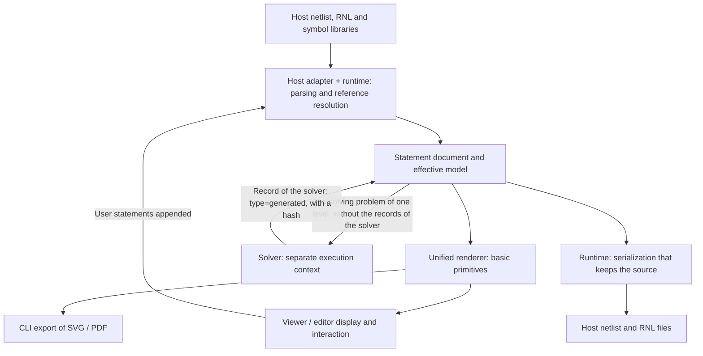

# Architecture and technology stack of the independent RNL toolchain

Status: an architecture proposal that records requirements and recommended choices; not yet implemented, and neither a frozen language standard nor a performance commitment. It is the proposal as of the dates below; where later decisions or the standard differ from it, they prevail.

Date: 2026-09-23. Revised 2026-09-23, taking in the conclusions of the first review discussion, mainly on the solver's output contract and ownership (section 3.3 and chapter 5), the runtime's form and modes of running (chapters 4 and 6), host adapters (section 4.1), the unified renderer (section 4.3), the solver's determinism and dependency policy (section 4.2), fonts (chapter 7) and the order of delivery (chapter 11). Revised 2026-09-24, after the move to the independent repository, recording the decided npm scope (section 9.1) and licences (chapter 12). Revised 2026-10-13: [decision 0008](decisions/0008-shared-core-per-platform-frontends.md) amended sections 6.1 and 6.3 and chapter 7, and added to the layout of chapter 8: the shared Rust core decides the drawing (placed primitives and the fonts shipped with the core), the desktop calls the core natively, and the frontends of each platform may differ; the original text of these places is kept below, and the decision prevails. Revised 2026-10-16, following language standard 0.2, the unpublished draft 0.3 and the implemented solver interface (rnl#16): rewrote the parts about the solver, section 1.2, chapter 2, sections 3.2–3.4, sections 4.2, 4.3 and 4.5, chapter 5, section 10.2 and chapters 11 and 12. The solver's record, hash, levels, coordinates, the scope of writing back and how the editor writes all follow the standard; the original proposal's source marks, input fingerprints, scopes by instance path, integer grid coordinates and override diagnostics have been removed. Revised 2026-10-16: draft 0.3 settled the four questions listed in chapter 12, namely the time limit of the decision, the hints on discarding, the number domain and tolerance of "has a solution", and the facts a definition expands to being kept only in part. Sections 3.3 and 4.2, chapter 5, section 10.2 and chapter 12 have been changed to match.

Source: moved from `docs/standards/rnl-toolchain-architecture.md` on the `rich-netlist` branch of the Analog Canvas repository (`cascode-ai/analog-canvas`), commit `168ce69afc988b4e6a57816664fabdafb5d948ee` (2026-09-23), on 2026-09-24. Apart from adding this paragraph, the move changed only the wording that depends on where the document is: it removed the note that it was "kept in Analog Canvas for now, its home to be settled", updated the links to the two language drafts, and replaced "this repository", where chapters 8 and 12 meant Analog Canvas, with its name; the content of the proposal was not changed. From then on this repository is the only place where it is maintained.

Licence: published by the copyright holder under [CC-BY-4.0](../LICENSES/CC-BY-4.0.txt); the licences of the parts of the repository are in the [licence notes](../README.md#license). The frozen copy in Analog Canvas remains available under that repository's AGPL-3.0 terms.

This document plans an independent Rich Netlist (RNL) runtime, solver and viewer/editor, with their modules, repositories and distribution. The target toolchain does not depend on Analog Canvas's code, runtime environment or component assets.

For the language, see the [RNL principles](../spec/rich-netlist.md) and [language standard 0.2](../spec/rnl-0.2.md) (this document was written before the standard; the syntax discussion draft 0.1-draft.2 it was based on has been replaced by the standard). Draft 0.3, which has the solver write back everything, is not yet published; the clauses this document cites follow commit f76197d (2026-10-16) of the research repository rnl-dev. The toolkit already implements it: files that declare 0.3, and main files without a header record, are read as 0.3 without a switch; see [rnl-runtime](../crates/rnl-runtime/README.md#for-a-solver). The interface names, directory names, package names and capability conventions in this document are design sketches; they do not imply existing implementations and add no confirmed RNL syntax.

## 1. User requirements and status of the proposal

### 1.1 User requirements

The following requirements were gathered from the user's step-by-step clarifications in this discussion and are the input to the proposal. The later recommendations of Rust, TypeScript, Tauri, a monorepo and the like are not implementation choices the user has prescribed.

1. **An independent, lightweight tool for reading RNL.** A good viewer of its own for Rich Netlist, with room to grow into an editor.
2. **Fast start-up refers to the framework and the interface.** What matters is how fast the software framework starts and the window and interface load to an interactive state; solving time does not count towards this requirement. Solving can first give the user an initial version and then refresh it with better results.
3. **Cross-platform matters from the start.** The hope is for a PDF-like experience: a good viewer on almost every platform. The application architecture may differ between platforms, but core capabilities such as solving and rendering should come as unified, portable modules.
4. **Key computational modules stress execution efficiency.** Above all the solver, with a preference for efficient compiled languages such as Rust or C++, while keeping portability and unified builds and releases on every platform after upgrades.
5. **No dependence on Analog Canvas at all.** Not on its frontend, its runtime environment or its existing component resources. The existing Canvas may serve only as a reference for the concepts of circuit information, hierarchy, connections and interaction.
6. **The viewer carries no domain assets.** RNL will be able to define symbols inline, and the standard symbols are published as RNL libraries; the viewer provides general parsing and display, and does not presuppose a built-in component library of its own.
7. **The solver and the renderer/editor are the two cores.** They may use different languages and platforms. The solver uses a compiled language; the frontend may use a JS solution that starts fast enough, or be a native application written in Rust.
8. **The full document semantics are kept between the two cores.** What passes between them includes the circuit and its hierarchy, components and symbol definitions, wiring and connections, so that the frontend can keep editing; it cannot be only drawing data that has lost the identity of the circuit's objects.
9. **RNL itself is the contract as well.** Since RNL can define graphics exactly, the solver can translate high-level semantics into an exact RNL description while keeping the original semantics, expressing its result with the language's mechanism of later descriptions overriding earlier ones. No separate circuit exchange format is needed.
10. **The viewer can read exact RNL directly.** When a complete, exact description exists, it is rendered directly; RNL that is not yet exact may call the solver as needed. Calling the solver is not a required step every time a document is opened.
11. **No text exchange is required at run time.** The solver and the viewer may actually communicate through efficient data structures or other channels, as long as they express the same RNL semantics.
12. **Keep up with the early standard's rapid evolution.** The language will change often at first, so the technology stack and frameworks must make fast iteration and distribution easy, with npm-like installation, upgrades and module consumption preferred.

This document also answers how the technology stack fits together, and whether the runtime, solver and viewer/editor are managed in one Git repository or several. The repository and release strategy belong to the recommendations given below.

### 1.2 Choices this proposal recommends, still to be validated in implementation

| Item | Recommended choice | Still to validate or confirm |
| --- | --- | --- |
| Core language | Rust; every dependency of the solver must be implementable in pure Rust and compile to WASM | Decision and coordinates by an incremental rational simplex (section 4.2); scale and performance to be validated |
| Host dialects | Structural subsets of both SPICE and Spectre in the first version | The exact extent of the subsets, the comment carriers, and validation of faithful write-back |
| Runtime form | A support library, linked in-process into the viewer, the CLI and the solver | The time WASM takes to parse large files |
| First frontend | A TypeScript viewer/editor; the unified renderer in the Rust core; SVG output | Behaviour on real complex drawings, high DPI and large hierarchies |
| Application UI | React + Vite, with the core not depending on React | Actual load size and first-screen behaviour |
| Desktop shell | Tauri 2 | Cold start, WebView and file integration on each platform |
| Source control | A new independent monorepo | The independent repository's name and the migration arrangements |
| SDK distribution | npm + WASM, with Rust crates and native artifacts | Package names, public API, release platform matrix |
| Versioning | Core SDK packages released together early on, the symbol library versioned on its own | Compatibility window, breaking changes and migration strategy |

A native Rust frontend is an optional later route; two frontends need not be maintained at first. Skia, tiny-skia, Qt, egui and the like are not required dependencies of this proposal; if the web frontend misses measured targets, a choice will be made around the specific gap.

## 2. Overall architecture: RNL to exact RNL

The solver interprets the intent of the presentation, settles every position, orientation and route not yet determined for one level, and writes the result as one record of the solver for that level (`type="generated"`, section 3.3). The viewer interprets descriptions that can be presented directly, produces basic primitives and provides interaction; it makes no layout decisions. The formal semantic contract between the two is still RNL: the results the solver hands to the viewer may contain only what RNL can express exactly (14.8 of draft 0.3).



This allows three independent ways of use:

- A viewer without a solver opens a file that already has a complete, exact description.
- The CLI or a background task solves semantic RNL into exact RNL and hands it to any compatible viewer.
- The editor works with the solver, user edits and background optimization sharing a versioned document state.

## 3. RNL as the data contract

### 3.1 Electrical facts and display descriptions

The host netlist still defines devices, parameters, terminal order, subcircuit interfaces and electrical connections. RNL refers to these facts, interprets them and presents them. The solver's layout output cannot add or change electrical facts; lines touching, crossing or sharing end points cannot create new electrical connections.

The in-memory model should keep a read-only projection of the host circuit, with references to it. The viewer can use it to search devices, trace nets and enter levels; it should not keep a second, competing electrical authority for the sake of display.

If a future editor supports changing the netlist, that needs explicit host edit and write-back operations. Changing RNL's presentation descriptions does not implicitly change the electrical structure.

### 3.2 A convention for what can be rendered directly

A convention within the same language for what can be rendered directly is proposed, called `render-ready profile` for now; it is not another file format. Its content is still to be specified; candidate conditions include:

- The symbols and necessary resources used in the current display range can be resolved.
- The necessary positions, orientations and sizes of objects are settled.
- The paths, labels and annotations to be shown have enough geometric information.
- The levels, references and scopes are enough to determine the effective descriptions.
- The necessary geometric decisions no longer depend on constraint solving.

The judgement can be made for the current cell or display range, without expanding the whole instance tree. Keeping high-level semantics in a file does not prevent direct presentation; whether to call the solver depends on whether geometry is missing or out of date, or the user asks for optimization.

The viewer does not fill in the layout of a partly exact file itself. From draft 0.3 the solver must write back all its decisions (section 3.3), so a solved file can be drawn the same without the solver installed. For parts not yet solved, or whose results are out of date, the viewer draws what is settled as usual:
- a wire with points whose positions are not settled: the settled segments are drawn, joined by flylines;
- a text whose position is not settled: placed beside the object it is attached to;
- an `"auto"` wire: drawn by the toolkit's default rule (13.1);
- an object without a position: listed as not drawn, with the state "needs solving".

Expanding a wiring mode, for example generating the bends of a right-angle connection given only its anchors, is a pure-function rule in the runtime, shared by the solver, the CLI and the editor.

The Document can give the solving state of each level on request, for the frontend to decide when to call the solver (decision 0008):
- no solving needed;
- not solved;
- solved: the hash of the record of the solver matches the current input;
- out of date.

In the CLI it is obtained with `rnl view --status`.

Without a solver, the viewer gives a clear state and the document information available for the parts it cannot present directly; it cannot pretend that solving is done.

"Exact" means that the necessary geometry is settled; it does not promise the same pixels on every platform. Fonts are decided by the viewer's environment; see chapter 7.

### 3.3 The solver's output, overriding and marks

This section was originally the model set by the review discussion. Standard 0.2 has since settled how the solver's output is written (2.8, 8.5, 14.8, chapter 17); what follows follows the standard, with the changes of draft 0.3 noted.

- **One record of the solver.** The solver writes the result for one level as one record: `@RNL(type="generated", priority="high", author="…", hash="…") {…}`.
  - Where: at the end of the level's own text. For a subcircuit, within its `.subckt … .ends`, even in an included file; for the top level, at the file level of the main file.
  - The solver's output does not use `scope` (2.6).
  - At the next solving, this record is replaced as a whole (chapter 17).
- **The records of the solver are not counted in the interpretation when solving.**
  - An old result does not constrain the next solving; the input of solving is the designer's statements and the editor's records.
  - 0.2 says that these records are not read when solving. Draft 0.3 relaxes this to "not counted in the interpretation, and how else they are used is up to the solver": the solver may take the old result as the initial value, or choose by it between equally good solutions, that is, warm start.
- **Write back all decisions (14.8 of draft 0.3).** Every position, orientation and route the solver settles is written into its record:
  - an object with a name or a key, by its name;
  - an object without a name, by number, such as `%#3`, with a `numbering` check value in the record header (5.9);
  - the route of an `"auto"` wire, by rewriting the wire with WIRE (13.1);
  - an object generated by a rule, as an explicit statement (10.5).

  A decision not written back is not a result, and the object is still free, so a viewer without the solver that draws from the record draws the solver's drawing. In 0.2, objects without names and the routes of `"auto"` wires cannot be written back; the toolkit lists each such decision as "not solved" rather than dropping it silently.
- **Interfaces are equivalent to RNL (14.8 of draft 0.3).** A result the solver hands to another tool in any form, such as a message to the viewer, may contain only what a record of the solver can hold, and any such result can be stored as such a record. So when the viewer applies a result, it takes the same path, "write it into the workspace, then read it as usual" (decision 0008).
- **Resolving conflicts (8.5).**
  - Geometric facts are first ordered by priority, and at the same priority the one written later comes first; they are then taken in one by one, and one without a solution is discarded. The result is the consistent subset that is lexicographically greatest in this order.
  - "Has a solution" is decided over the reals: there are real coordinates, and a value for each free orientation, that make all the facts hold within the tolerance; integer grid points are only the solver's goal (8.5 and 11.7 of draft 0.3).
  - The solver must keep facts this way, and the implementation's own concerns (such as no overlap, the grid, looks) come after all the facts. Draft 0.3 adds a note: 8.5 specifies which facts are kept, not how they are found.
  - **Hints on discarding** (8.5 and 7.6 of draft 0.3):
    - every minimal conflict set is listed, each fact by the statement that wrote it; a minimal conflict set is a set of facts taken in that has no solution together with the discarded fact, and has one with any one of them left out;
    - each statement in a conflict set gets a hint as well, saying which facts were discarded because of it;
    - when they are not all found within the time limit, the hint says that the list is not complete;
    - a `low` fact being discarded is expected, and these hints may be left out.
  - **The time limit of the decision** (8.5 and 7.6 of draft 0.3):
    - the decision can be slow, so an implementation may limit its time. The limit is a solver option the user can set; the standard sets no value, and the toolkit's default is 5 seconds.
    - A fact whose decision is not finished within the limit is discarded, with a warning that it was not decided.
    - With no limit, or when no decision reaches the limit, the result is the one defined above; when the limit is reached, the result may differ from it, and from run to run.
- **The hash only gives a hint (chapter 17).**
  - The hash is computed from the level's actual input after inheritance: the rules that flow down and take effect, the symbols chosen, the versions of the packages and the solver options, not the records of the solver or metadata.
  - The algorithm belongs to the tool, and the value carries an algorithm label. The toolkit's `sig1` has two parts, `sig1:<input>.<options>`; the viewer does not know the solver options used then and compares only the input part.
  - When it does not match, the old result takes effect as usual, and the viewer suggests solving again.
  - Draft 0.3 also has the `numbering` check value, defined by the standard, which only answers "do the numbers still point right": when it does not match, the statements that use numbers take no effect, those objects go back to waiting to be solved, and the rest are as usual.
- **The user's changes (14.8, chapter 17).**
  - The user does not edit the solver's record by hand.
  - The editor writes a drag as a position with `priority="high"` in its own record (`author` is the editor), appended after the record of the solver; in every later solving it is a fixed position.
  - To change a constraint the designer wrote, change the designer's record directly.

High-level semantics and exact descriptions can exist together: the coordinates the record of the solver gives sit alongside semantics such as symmetry; at the next solving the record of the solver takes no part in the interpretation, and the symmetry semantics are still an input to solving. Whether a later description overrides an earlier one still follows the language's rules for the operation, object and scope concerned (8.4, 8.5). A complete example is in chapter 17 of the standard.

### 3.4 Four layers of representation

| Layer | Information kept | Use |
| --- | --- | --- |
| Source text and syntax | The file of origin, ranges, ordinary comments, unknown records, encoding and line endings | Diagnostics, exact editing and write-back that keeps the text |
| Statement document | RNL statements ordered by level, record headers (`type`, `author`, `hash`, and `numbering` in draft 0.3), relations of origin | Editing, appending, write-back, computing hashes, replacing the record of the solver as a whole |
| Effective model | The host circuit's projection after overrides and inheritance by level, levels, symbols, object slots (with a value or free), semantic constraints | Input of the unified renderer; read without the records of the solver, the solver's solving problem is derived from it |
| Basic primitives and caches | Primitives such as lines, fills and texts, with their object identities, bounding boxes, spatial index, optional GPU data | Display and hit testing in the viewer, export from the CLI |

The statement document and the effective model are both in-memory representations of the runtime, the latter derived from the former. The solver consumes the solving problem (`LevelProblem`, section 4.2), that is, the part of the effective model, read without the records of the solver, that the solver needs; the solution it gives is written by the runtime as a record of the solver, replaced back into the statement document. The document model is an implementation representation of RNL and does not set up a second, independent circuit language.

For the content supported, receiving an update directly in memory and writing the update as RNL and reading it again should give equivalent document semantics. Internal IDs, caches and session revision numbers need not be part of the file format, but object identities or origins that affect semantics must not be lost. The numbers `%#n` of draft 0.3 are not internal IDs: they are given only to objects that cannot be reached by name, and are determined entirely by the text. The runtime has internal identities of its own that do not move with the text, and records each object's reference in the file (a name, or a number).

## 4. Module responsibilities and dependencies

### 4.1 Runtime and host adapters

The runtime is a support library, not a separate process or service: the viewer links it in-process as WASM, and the CLI and the solver link the native build. One runtime version dispatches interpretation by the language version a file declares, rather than loading several runtime builds side by side in one application; an application fixes one runtime release.

The runtime implements RNL's lexing and parsing, scope and reference resolution, override rules, interpretation of symbol definitions, pure-function rules such as expanding wiring styles, diagnostics, document transactions and serialization. Parsing and solving are separate modules; syntax changes should not reach into the search algorithms directly.

The host adapters are a layer of their own, one package per dialect. An adapter recognizes valid comments and safe positions, parses devices, terminals, nets, subcircuit interfaces and levels, provides the records in the order the host expands includes, and is responsible for that dialect's faithful write-back. Adapters give the runtime core a unified interface to the host circuit model, and the core depends on no particular dialect. Terminal names and terminal order are knowledge of the host language, provided by the adapter; the syntax draft says explicitly that terminal names cannot be guessed from the conventions of device types.

The first version supports structural subsets of both the SPICE and Spectre dialects: instances, nets, subcircuit definitions and interfaces, includes, model identity; it does not evaluate expressions or interpret simulation control statements. Both dialects go into the first version so that the interface to the host circuit model is dialect-neutral from the start, and so that cross-dialect equivalence tests exist: the same circuit written in the two dialects, with the same RNL, must give the same effective model.

The host provides the contents of files, includes and resources through an interface; the runtime does not bind directly to desktop paths, network downloads, the DOM or the window system. The TypeScript frontend gets the statement document and the effective model through the runtime, and does not keep a second set of rules for overriding, scope and reference resolution.

### 4.2 Solver

The solver receives the solving problem of one level and the solver options, keeps the search state and gives the level's solution, which the runtime writes as a record of the solver. It outputs no DOM, SVG elements, triangles or pixels, and refers to no internal types of the viewer.

**Input and output.** This part is implemented in the runtime (rnl#16; see [rnl-runtime](../crates/rnl-runtime/README.md#for-a-solver)).

- **Input.** The solver reads the document with `Options::solver()`, that is, each level interpreted without the records of the solver. Each drawn level gives a solving problem `LevelProblem` (the `problem` module; `rnl problem` can print it), which includes:
  - the objects to place: one slot per axis (free, or fixed by which fact), the orientation (free or fixed), the reference used to write back (a name, or a usage generated by a rule with its path; under draft 0.3, objects without names have numbers);
  - symbols: the box, the positions of the pins, their directions and terminals;
  - geometric facts: already ordered by 8.5, the index being the rank; their members are all points, that is, origins, pins, the centres of sets or the extents of sets;
  - the wires already written, the nets to route (ROUTE), GROUP;
  - each usage: the definition's name and the roles; semantic usages can serve the solver as hints;
  - the language version the file declares.
- **Output.** The solver gives a `Solution` (the `solution` module): positions and orientations, the wires and branches routed for ROUTE, and the routes of existing `"auto"` wires.
  - The runtime writes it as a record of the solver (`write_record`; under draft 0.3, `finish_record` adds `numbering`), and lists, one by one, the decisions that cannot go into the record, with the reasons.
  - `Solution` is designed so that any one of them can be stored as a record (section 3.3).
- **Two aids.**
  - `previous` maps the level's existing record of the solver onto this solving problem, for warm start.
  - The Document can give the solving state of each level on request (section 3.2).

**Levels.** One subcircuit definition is one drawing (6.1), and one task solves only one level. When solving, every description in effect at the level takes part, including statements written into it from above with `scope`; the result is written into the level's own text (section 3.3). The range of solving can be configured as the whole file level by level, only the top level, or any subcircuit. Taking a subcircuit out on its own into another environment is a matter for export tools; RNL files should not be taken apart and used directly.

**Algorithm (designed, being implemented).** Structure first, with the resolution of conflicts separate:

1. **The arbiter of 8.5 is a separate component that looks only at the language's facts.**
   - Orientations: a union-find with D4 group labels, merging related orientations into orientation classes.
   - Coordinates: one incremental rational simplex per axis, with bounds, with explanations, and able to undo.
   - Discrete choices: backtracking search over the simplex. Discrete choices come from ORDER and DISTANCE given only an axis, upper bounds of set extents, centres of sets with three or more members, and free orientations that affect the positions of pins.
   - When a fact is discarded, every minimal conflict set is given, as 8.5 of draft 0.3 asks (section 3.3).
   - In general the decision is NP-hard, so it has a time limit, set by the user, 5 seconds by default in the toolkit. A fact not decided within it is discarded with a warning (section 3.3).
2. **Candidate search.**
   - First the structure of the problem is found: the group tree, the choices still open after arbitration, the connections.
   - Then candidates are generated by configurable layered goals. A candidate is a set of discrete decisions: orientations, rows and the order within a row, the arrangement of each group, which side of a disjunction is taken, and so on; a beam search runs bottom-up along the group tree.
   - The structural relations a candidate brings come after all the language's facts and are also checked by the arbiter; incompatible ones are not added, so the user's facts are never discarded because of them.
3. **Coordinates.** For each candidate, each axis solves a series of lexicographic LPs with the same simplex, in a configurable order of layers. With only difference constraints the optimal vertex is integral; constraints such as equal spacing may give fractions, which the standard allows.
4. **Routing and scoring.** ROUTE nets are routed at right angles between the placed components; then candidates are scored by the layered goals, lexicographically between layers and weighted within a layer, and the best is chosen.

**Coordinates and tolerance.**
- "Has a solution" is decided over the reals, and integer grid points are only a goal (8.5). The grid is the solver's own concern, coming after the language's descriptions, and fractions the facts force are written as they are.
- In deciding and checking constraints, a difference within the tolerance counts as holding; the tolerance is a solver option the user can set, and the standard sets no value (11.7 of draft 0.3).
- The solver uses rationals internally and writes back decimals that read back as the same value. A value such as 1/3 that has no finite decimal is written with enough digits that, when the record is read back, the facts it satisfies still hold within the tolerance.

**Determinism is a design requirement.**
- The decision uses no floating-point comparisons.
- The limit of the decision is time, set by the user (section 3.3); the budgets of candidate search and routing are counted in work, such as the number of candidates and routing expansions, not in time.
- As long as no decision reaches the time limit, native and WASM builds of the same solver version give byte-identical output for the same input and options. When the limit is reached, the results may differ, and from run to run (8.5).
- The solver options (the order and weights of the goals, the tolerance, the time limit of the decision, the search budgets) are part of the input of solving and count in the options part of the hash; writing options into the file is a reserved item of Annex C of the standard.

**Warm start.** Draft 0.3 specifies only that the records of the solver are not counted in the interpretation when solving, and how else they are used is up to the solver. `previous` gives the positions, orientations and routes of the old result, for the solver to use as initial values and as a preference in ties, so that the drawing does not jump much after a small change. The first solving has no old result and must still give a good drawing.

**Dependency policy.** A WASM target cannot link C++ libraries directly, and the WASM versions of SMT and MIP solvers do not suit in size and start-up time. So every dependency of the solver must be pure Rust and compile to WASM, for example `num-rational` for rationals; no SMT or LP library or C binding is brought in.

The output keeps stable object references, levels and the necessary net associations. Symbol definitions, terminal positions and orientation transforms are provided by the document and cannot depend on hard-coded device resources.

### 4.3 Unified renderer, viewer and editor

Rendering has two stages. The first is the unified renderer, in the shared Rust core: it expands symbol instances and transforms, and translates RNL's graphic descriptions into basic primitives such as lines, fills and texts, each with an object identity and a bounding box. The second stage, the final output, is done by each tool: the viewer draws SVG, the CLI exports SVG or PDF, and golden tests compare primitive lists or output files. So the three outputs agree, hit testing uses the primitives' bounding boxes directly, and a future native Rust frontend reuses everything but the final drawing and the UI.

The viewer implements zooming, panning, selection, hit testing, search, net highlighting and level navigation. The runtime and the renderer are in the same process and thread, so these queries are all synchronous calls, not across a Worker or IPC. The viewer makes no layout decisions.

The editor provides editing tools, transactions and undo/redo on top of the viewer, validating and applying document changes through the runtime.

- **Dragging.** The user's manual adjustments are written into the editor's own record (`author` is the editor). A drag is written as a position with `priority="high"`, appended after the record of the solver, and in every later solving it is a fixed position (14.8, chapter 17).
- **Wiring while dragging.** When a device is dragged, a lightweight router built into the editor redraws the wires concerned, without requiring the solver online. The router's result is a solver result and may be written as the editor's own `type="generated"` record, replaced as a whole at the next solving like the solver's record; whether to do so is up to the editor. The language does not distinguish "temporary placement" from "locked".
- **Changing the shape of a wire.** From draft 0.3, when the user changes the shape of a wire, the editor rewrites the wire with WIRE in its own record (13.1); the solver, reading it, no longer changes it.
- **Changing an object generated by a rule.** To drag an object generated by a rule on its own, such as the ground in a ground stub that a rule adds, the editor first writes it as an explicit object in its own record, as 10.5 says, and then writes the drag (the note in chapter 17 of draft 0.3).

The editing basics of the first version centre on presentation and constraints. Full host netlist editing is an additional capability whose limits must be settled separately.

### 4.4 Direction of dependencies

```text
host adapters → runtime core interface
solver        → runtime
renderer      → runtime (both in the shared core)
viewer        → runtime + renderer, linked in-process
editor        → viewer + the runtime's editing interface + lightweight router
application   → the modules it needs + a solver transport adapter
```

The runtime does not depend on the solver, the viewer or the standard symbol library; the viewer does not require the solver. The two are connected by the application or by a separate adapter, and installing the viewer should not pull in all the solving dependencies.

### 4.5 Mechanisms for a fast-changing language

Requirement 12 is supported by the following mechanisms; distribution only solves "how to ship it". These mechanisms are recorded in this round and are still to be validated in implementation:

1. The catalog of operation signatures is a data file, with all the information section 9.1 of the syntax draft asks each operation to declare; parsing checks, documentation tables, TS types and the skeletons of conformance tests are generated from it. Adding or changing an operation is one data file plus one semantic handler.
2. The schema of the effective model is defined once, in Rust; the TS types are generated, not hand-written mirrors.
3. The conformance corpus is a directory of "host files plus the expected effective model", labelled with language versions; the native and WASM runtimes run the same one.
4. A migration tool moves the corpus and the samples from one draft version to the next, so that breaking changes do not make the samples obsolete.
5. The solver depends only on the runtime's solving problem and solution (the `problem` and `solution` modules), and the viewer only on the Document; neither depends on syntax-layer types, so syntax changes that leave these unchanged are invisible to both.

## 5. Incremental solving and concurrent editing

### 5.1 The solving protocol

The solver's public contract is a message protocol, not in-process functions. By decision 0008 the solver's code is part of the shared core, and where it runs is up to the frontend: in a native background thread on the desktop and in the CLI, and as WASM in a Worker on the web. The same protocol can also serve a future remote solving service.

```text
start(workspace, level, options)
update*  → the level's complete record of the solver (RNL text), state, hints on discarded facts
done | cancelled | failed
cancel()
```

- **The input is the workspace.** The solver has its own runtime instance and receives the workspace, that is, the texts of the files, and reads the solving problem itself, so no exchange format for the effective model needs defining.
- **An update is a complete snapshot.** Each update is a complete snapshot of the level's record of the solver, idempotent; no deltas against the previous update are sent. The frontend writes it into the workspace, replacing the level's previous record of the solver, and reads it as usual. The UI can show an initial result first and then receive better ones; the pace of updates is decoupled from the frequency of solving iterations, and the latest result is consumed first to avoid a backlog.
- **There is no "no solution" end state.** Under 8.5 a conflict of facts is not a failure: the conflicting facts are discarded and there is always a result, so there is no "no feasible result". A fact whose decision reaches the time limit is discarded too, listed in a warning; when the search budget is used up, the best result so far is given, ending with `done` and a note. `failed` means only that the implementation went wrong.
- **A single thread is the baseline of full function.** Advancing in slices of work is a primitive inside the solver, used for the single-threaded fallback; an advance does not recreate the whole solving problem. Multiple threads may only compute fixed batches of candidates in parallel, merged by fixed numbers, without affecting the result; they are not a prerequisite for reading exact RNL.

### 5.2 Update envelopes

| Kind | Content |
| --- | --- |
| Solving request | Task identity, workspace (the texts of the files), target level, solver options |
| Solving update | Task identity, the hash of the input it is based on, update sequence number, target level, the text of the record of the solver, state, the discarded facts (including those not decided) with all their minimal conflict sets |
| Edit transaction | Base revision number, the operations to write (a transaction of `rnl-edit`), origin and transaction identity |

Structured messages come first. Binary encodings or transferable buffers are added only after a clear transport bottleneck appears. JSON is only a possible transport encoding, not a second formal document format.

### 5.3 Invalidation and ownership

How three kinds of information are expressed in the file:
- the designer's constraints: the designer's records;
- the solver's current result: the record of the solver with `type="generated"`;
- the user's changes in the editor: the editor's own record, a drag being a fixed position with `priority="high"`.

To fix a value, the user writes it in their own record; a result is not "accepted" by changing the record of the solver (chapter 17).

Updates from an old task cannot override new edits. An update carries the hash of the input it is based on; when it does not match the input part of the current workspace, the frontend discards the update and cancels or restarts the task. Zoom, selection and the current level are not solving output and should be kept across updates.

When the user appends statements after the record of the solver, the input part of the hash changes with them, and the viewer marks the level as out of date and suggests solving again. The next solving replaces the record of the solver as a whole; see section 3.3.

### 5.4 Saving and opening again

A later write overriding an earlier one decides only the effective value. Whether a solving result still suits the current input is judged by the hash. The hash is written in the header of the record of the solver and saved with the file; any tool that knows its algorithm label can compare it, and one that does not, does not compare (chapter 17). When the file is opened again:
- the input part of the hash matches: solved, drawn directly, no need to solve again;
- it does not match: the old result takes effect as usual, marked as out of date, with a suggestion to solve again;
- draft 0.3's `numbering` does not match: the statements that use numbers take no effect, those objects go back to waiting to be solved, and the rest are as usual.

An old result is never a constraint on the next solving (section 3.3).

When only RNL is changed, the host text and ordinary comments should be kept; reading, diagnosing and saving unknown content follow the policy for the supported language versions. The original file cannot be rebuilt from the solved display projection alone.

## 6. Technology stack and modes of running

### 6.1 Recommended combination

| Module | Recommended implementation | Reasons |
| --- | --- | --- |
| Runtime / host adapters / unified renderer | Rust, separate crates, shared core | Native execution, WASM compilation, the same output from the CLI and the viewer |
| Solver | Rust, pure-Rust dependencies | Both native and WASM paths, determinism |
| Web bindings | wasm-bindgen, with build tools such as wasm-pack | Generates the JS interface and wraps it as an npm package |
| Viewer / editor | TypeScript, with the core not depending on React | Fast iteration, embedding in browsers and npm distribution |
| Final output | SVG to start | Vectors, text, interaction and easy early debugging; the primitive list is not tied to SVG, and the backend can be replaced |
| Application interface | React + Vite | Ordinary UI and build tools, kept apart from the RNL core |
| Desktop shell | Tauri 2 | Reuses the web frontend and adds native solving and file capabilities |
| CLI | Rust | Checking, solving, rendering and serialization without a UI |
| Symbol library | RNL data packages | Evolves independently of the engines and applications |

Both Rust and C++ can implement efficient solving; neither language by itself is guaranteed to be faster. Algorithms, data layout, incremental computation, allocation and hot spots are optimized first. For the dependency policy see section 4.2: a portable host language does not mean that all dependencies are portable.

### 6.2 Web

```text
React interface + TypeScript viewer/editor
        ↕ synchronous calls, in-process
WASM runtime + unified renderer on the main thread
        ↕ solving message protocol: snapshots / complete updates
WASM solver in a Worker, with its own runtime instance, loaded on demand
```

The runtime and the renderer are on the main thread, so hit testing, search and highlighting are synchronous calls; parsing very large files can move to a Worker after validation, sending back a serialized effective model. The solver loads separately, and loading the interface does not wait for the solver to download, initialize or solve. If the solver's WASM uses multiple threads, it needs SharedArrayBuffer, so deployments must send cross-origin isolation headers; static deployments must check this. A single-threaded solver has no such requirement.

### 6.3 Desktop

```text
Tauri WebView: the same TypeScript viewer/editor + the same WASM runtime and renderer
        ↕ solving message protocol: Tauri channel
Native solver in a Rust background thread; file reading and writing, file associations, drag-in and updates provided by Tauri
```

> Amended by [decision 0008](decisions/0008-shared-core-per-platform-frontends.md): the desktop calls the shared core natively and does not run WASM in the WebView; the desktop and web frontends may share interface code but need not be the same.

The frontend code path is exactly the same on the desktop and the web; Tauri only plugs into two seams: file I/O and the solver transport. The native solver meets requirement 4's execution efficiency. If the WASM on the WebView side uses multiple threads, custom protocols need cross-origin isolation headers as well.

Tauri uses the system WebView; a small installer proves neither a fast enough cold start nor that every Linux distribution works out of the box. Dependencies and behaviour must be validated on the target systems.

### 6.4 Mobile and a future native frontend

Reading exact RNL in mobile browsers is validated from early in the project, and the runtime and solver keep the ability to compile for mobile. A full native mobile application may use a validated shared shell, or connect to Swift/Kotlin through an interface such as a C ABI.

If measurements on the desktop miss the start-up or interaction targets, a native Rust frontend can be built. It reuses the runtime, the solver, the unified renderer, the hit-testing logic, the RNL libraries and the conformance corpus; only the final drawing and the UI code of TypeScript need rewriting, which must be counted in the implementation cost of a second frontend.

Cross-platform first guarantees consistent semantics and declarable capabilities; it does not promise the same UI, the same execution speed or pixel-identical drawings on every platform.

## 7. Symbols, fonts and document resources

The viewer understands general capabilities such as paths, transforms, terminals and text, but carries no device catalog or built-in component graphics. The standard symbols are defined and published through ordinary RNL libraries.

Resource resolution is provided by the host; supporting local document dependencies, libraries of explicit versions and dependency sets that can be carried offline is suggested. Versions or content hashes prevent the same file from giving different drawings as a "latest" library changes.

A sharing experience close to PDF needs the recipient to be able to get all the necessary resources. A form of document distribution that can bundle dependencies can be designed, but its container format, manifest and rules for relative paths are not settled; the appearance of a type name does not trigger network access by itself.

> Amended by [decision 0008](decisions/0008-shared-core-per-platform-frontends.md): fonts ship with the core, the renderer lays out text by their metrics, and the frontend only draws, so text positions are the same across platforms; the specific fonts and their licences are to be decided.

Fonts are provided by the viewer's environment and can be configured. In the viewer, labels can change font or size or be hidden; the solver does not depend on actual text metrics, and a label crossing a line is not a correctness problem. This proposal sets up no font embedding, fallback for missing fonts, or metrics contract shared by the solver and the viewer, and does not promise the same look of text across platforms.

## 8. Source organization: one independent monorepo

A new repository independent of Analog Canvas is recommended, with the runtime, solver, viewer/editor, standard library and specification in one monorepo. The three main deliverables are module boundaries and need not correspond to three Git repositories. It is suggested that the language drafts and the conformance corpus move in when the repository is created, with Analog Canvas keeping only a link to the new repository.

Early on, one language change may change the specification, interpreter, solving output, rendering and tests at once. A single repository lets one commit or PR express the whole change and validate compatible combinations. Splitting repositories early adds dependency releases, cross-repository coordination and incompatible intermediate states.

Suggested layout:

```text
rnl/
├─ spec/                       # language and capability conventions; the normative source of the conformance corpus
├─ crates/
│  ├─ rnl-runtime/             # language core: parsing, scope, overriding, transactions, serialization
│  ├─ rnl-host-spice/          # adapter for the structural subset of SPICE, with faithful write-back
│  ├─ rnl-host-spectre/        # adapter for the structural subset of Spectre, with faithful write-back
│  ├─ rnl-render/              # unified renderer: effective model to basic primitives
│  ├─ rnl-solver/              # solving core
│  └─ rnl-cli/                 # checking, solving, rendering, migration
├─ bindings/
│  └─ wasm/                    # WASM binding entry: runtime + renderer; the solver has its own entry
├─ packages/
│  ├─ runtime/                 # npm interface and generated types
│  ├─ solver/                  # npm solving interface and Worker wrapper (planned, no directory yet)
│  ├─ viewer/                  # drawing primitives and browsing (planned, no directory yet)
│  └─ editor/                  # editing tools, transaction interface and lightweight router (planned, no directory yet)
├─ libraries/
│  └─ standard/                # the standard RNL symbol library
├─ apps/
│  ├─ web/                     # reference web application
│  └─ desktop/                 # Tauri application
└─ tests/
   ├─ conformance/             # language conformance, cross-dialect equivalence
   ├─ roundtrip/               # reading, changing, writing back
   └─ integration/             # from solving to display and editing
```

> Note of 2026-10-25: the top-level `examples/` of the original plan only ever held its README and has been removed; examples are in `site/examples/`, `skills/rnl/examples/` and rnl-gallery.

> Added by [decision 0008](decisions/0008-shared-core-per-platform-frontends.md): `crates/` also holds `rnl-view/`, the core interface: its input is the workspace (the texts of the files) and its output the Document; the desktop, CLI and web frontends all get what to show through it.

Rust uses a Cargo workspace and TypeScript a pnpm workspace. The two toolsets coexist, each managing its own dependencies and builds, coordinated by root-level scripts and CI; no heavier unified build system is needed at first.

A single repository does not allow bypassing module boundaries to refer to internal implementations directly. Packages should still be consumed through their public interfaces, and independent installation after packaging should be validated. Splitting repositories can be considered later when independent teams, permission boundaries or stable, infrequent cross-module changes appear; if the standard comes to have its own governance, the specification and conformance tests can also be managed separately.

## 9. Distribution and versioning

### 9.1 Deliverables

| Deliverable | Suggested channel | Consumers |
| --- | --- | --- |
| Runtime / renderer / solver Rust libraries | Crates and native build artifacts | Rust applications, native hosts |
| Runtime / renderer / solver WASM | npm packages with their JS interfaces | Web, JS tools and embedding applications |
| Viewer / editor | npm | Web applications, desktop frontends |
| Standard symbol library | npm data packages and plain archives | Resource resolvers on every platform |
| CLI | Precompiled programs for each platform | Command-line users and automation |
| Desktop application | Installers and the application's update channel | End users |
| Web application | Static deployment | Browser users |

The npm packages use the registered `@rich-netlist` organization scope; see [decision 0003](decisions/0003-npm-scope.md). The package names `@rich-netlist/runtime`, `@rich-netlist/solver`, `@rich-netlist/viewer`, `@rich-netlist/editor` and `@rich-netlist/stdlib` express the intent for now; the exact names are still to be confirmed.

npm solves module distribution; it does not update installed desktop applications automatically. A unified cross-platform release means the same source version, locked dependencies, a test matrix and a manifest of artifacts; it does not mean that every platform uses the same binary, nor that app store reviews finish at the same time.

### 9.2 Layers of versions

| Version | Meaning |
| --- | --- |
| RNL language version | How a document is to be interpreted |
| SDK document interface / communication version | How the runtime, solver and frontends exchange structured data |
| Package version | The release of implementations, algorithms, fixes and APIs |
| Standard library version | The content of the symbols and other library definitions |

The interface version is not another circuit standard. If a syntax change is absorbed by the runtime and keeps the same effective model, the frontends and the solver need not change; a new capability that the frontends must understand needs explicit compatibility handling.

It is suggested that the core SDK packages be released together early on, offering validated compatible combinations, with the standard symbol library versioned on its own. Previews are published as `next`, validated versions as `latest`; applications fix a compatible combination rather than each tracking the latest version at start-up.

Versions and change logs of the JS packages can use Changesets; the versions of the Rust crates can be coordinated with release-plz or cargo-release. WASM, the CLI and the applications are coordinated by the same release pipeline; Changesets alone does not handle all of the Rust releases. Publishing across registries cannot be assumed to be atomic: the whole set of artifacts should be validated first and the recommended version promoted afterwards, and partly failed releases must be recognizable.

### 9.3 The basic flow of a release

1. Choose the source commit, fix the dependencies and toolchain, and record the supported range of the language and interfaces.
2. Build and test the native targets and WASM, and generate the types, bindings and release packages.
3. Validate independent installation and cross-module compatibility from the packaged artifacts, so that workspace links do not hide missing files.
4. Publish the preview artifacts and the compatibility manifest first, and promote them to the stable channel once they pass.
5. Publish the web application, the CLI, the desktop installers and the necessary signed artifacts.

The target platform matrix, minimum system versions, CPU architectures and signing arrangements must be settled explicitly; "cross-platform support" cannot stand in for release acceptance.

## 10. Validation and performance boundaries

### 10.1 Start-up and loading

Measure separately: process cold start to interactive, first and cached web loads, opening exact RNL to the first frame, solver initialization and first result, interaction latency during continuous solving, memory, and release size. Measurement needs a fixed set of reference documents in three sizes, small, medium and large, for example a single-level circuit of a dozen or so devices, a multi-level circuit of hundreds of devices and a circuit of thousands; without a reference corpus there can be no acceptance.

Start-up acceptance does not include solving time; nor may an application's implementation put solver initialization on the first-screen path it must wait for. Numeric performance targets will be set once the reference machines, drawing sizes and platform range are settled; there are no validated millisecond or size commitments now.

### 10.2 Semantics and interoperability

- The same document gives references, overrides and diagnostics under the same contract on the native and WASM runtimes.
- The SPICE and Spectre versions of the same circuit, with the same RNL, give the same effective model.
- The text channel and the memory channel give equivalent effective document semantics.
- A document with high-level semantics and complete geometry can still be read with no solver loaded at all.
- Saved after solving and opened again, it draws the solver's drawing without solving again (draft 0.3: all decisions are written back), and the input part of the hash matches.
- The hash is computed from the solving problem: changing only whitespace, comments or line endings does not change it, and changing a semantic statement does.
- All the facts the solver keeps hold; discarded facts get hints that name the facts they conflict with (8.5).
- Changing presentation descriptions does not change the host's electrical facts; write-back that keeps the text does not reorder the host text.
- Results of old tasks cannot override new edits, and undo/redo agrees with the document revisions.
- Native and WASM builds of the same solver version, for the same input and options, when no decision reaches the time limit, give byte-identical output; different options or versions may give different feasible layouts, which must not be mistaken for format incompatibility.

### 10.3 Rendering and resources

Validate symbol instantiation, terminal and orientation transforms, level selection, net associations, the state of missing resources and high-DPI behaviour. The unified renderer's primitive list is what the CLI and the viewer are both compared on; across platforms, suitable image tolerances are used, with semantics and geometry checked separately; screenshots alone cannot show that connections are correct.

### 10.4 Robustness

The viewer will open files from any source. The host adapters and the RNL parser need fuzz testing, and limits on include depth, level depth and file size; resources are loaded only through the host interface, with no network access by default and no code executed.

## 11. Order of delivery and acceptance questions

The following is the future order of implementation, not a list of work already started.

1. **The loop of reading exact RNL.** Implement a minimal runtime, structural subset adapters for the two host dialects, the unified renderer, external symbol libraries, checking and rendering in the CLI, and the TS viewer; open the same set of complete, exact cases without the solver installed, with the cross-dialect equivalence tests passing. Tauri cold start, WASM parsing time and IPC throughput are measured in parallel as separate items and do not block this stage.
2. **The loop of solving.** The solver writes all the decisions for one level as a record of the solver with a hash, supporting continuous updates, saving, reading again and detecting staleness; the same semantic implementation has native and WASM paths with the same output. The runtime side (the solving problem, write-back, the hash, hints from the old result, the solving state) was completed in rnl#16; the solver itself is in development.
3. **The loop of editing.** Appended user edits, the lightweight router, undo/redo, revision checks and solving again, validating the ownership of the editor's records and the records of the solver.
4. **The loop of release.** Independent installation from npm, CLI and desktop artifacts, validating carrying resources offline and compatible version combinations.
5. **Extending by evidence.** Decide on a GPU backend, binary channels, multiple threads, and whether a native Rust frontend is needed, by actual performance.

The first stage already needs to validate cross-platform behaviour and the boundary of the optional solver, rather than first completing every function on a single desktop environment and porting afterwards.

## 12. Questions still to decide

- The exact extent of the structural subsets of the two host dialects, the comment carriers, and the validation matrix of faithful write-back; the exact extent of the RNL syntax version and of what can be rendered directly.
- How the solver options (including the order and weights of the goals) are written into a file: a reserved item of Annex C of the standard. The hash's algorithm belongs to the tool; the toolkit uses `sig1`.
- Whether the lightweight router's results in the editor are written as the editor's own `type="generated"` record (section 4.3).
- The symbol definition language, loading of the standard library, version pinning and the form of offline containers.
- Whether the several facts one definition expands to can be declared "kept or discarded as a whole": draft 0.3 does not change this, each fact is still chosen on its own (8.5), and the item is listed as a reserved item of Annex C of the standard.
- Three things settled in draft 0.3 and moved out of this chapter (see sections 3.3 and 4.2):
  - the time limit of the decision is a solver option the user can set, and a fact not decided within it is discarded with a warning;
  - the hints on discarding list every minimal conflict set;
  - "has a solution" is decided over the reals, and the tolerance is a solver option the user can set.
- When draft 0.3 is published; until then, numbers, `numbering` and rewriting by WIRE stay behind a development switch and are not written into files.
- The first version's platform/architecture matrix and measurable start-up and interaction budgets.
- Crate naming, the compatibility window and release governance; the npm scope is settled as `@rich-netlist`, see [decision 0003](decisions/0003-npm-scope.md).
- The licences of this repository are settled (code MIT, specification and documentation CC-BY-4.0, data CC0-1.0); see [decision 0002](decisions/0002-licenses.md). Before porting code under the AGPL in the Analog Canvas repository (such as the Python solving prototype), its copyright holder must still relicense that part.

These questions do not affect the overall module division, but must be decided explicitly before the corresponding implementation or language capability is frozen.

## 13. Technical references

The following links are for checking what the tools can do and do not constitute performance guarantees; a formal project should pin dependency versions.

- [Cargo workspaces](https://doc.rust-lang.org/cargo/reference/workspaces.html): managing several Rust packages.
- [pnpm workspace](https://pnpm.io/workspaces): managing several JS/TS packages.
- [wasm-bindgen](https://github.com/wasm-bindgen/wasm-bindgen): bindings between Rust and JS/WASM.
- [wasm-pack](https://github.com/drager/wasm-pack): building WASM packages and the npm workflow.
- [Rust platform support](https://doc.rust-lang.org/rustc/platform-support.html) and [the limits of the WASM target](https://doc.rust-lang.org/rustc/platform-support/wasm32-unknown-unknown.html): target capabilities and support tiers.
- [The security requirements of SharedArrayBuffer](https://developer.mozilla.org/en-US/docs/Web/JavaScript/Reference/Global_Objects/SharedArrayBuffer): the cross-origin isolation multithreaded WASM needs.
- [Tauri architecture](https://v2.tauri.app/concept/architecture/) and [WebView platforms](https://v2.tauri.app/reference/webview-versions/): the desktop shell and its runtime dependencies.
- [Tauri: calling the frontend, and channels](https://v2.tauri.app/develop/calling-frontend/): the solver transport on the desktop.
- [Changesets](https://github.com/changesets/changesets): versions and change logs of several packages.
- [npm dist-tags](https://docs.npmjs.com/adding-dist-tags-to-packages/): preview and stable distribution channels.
