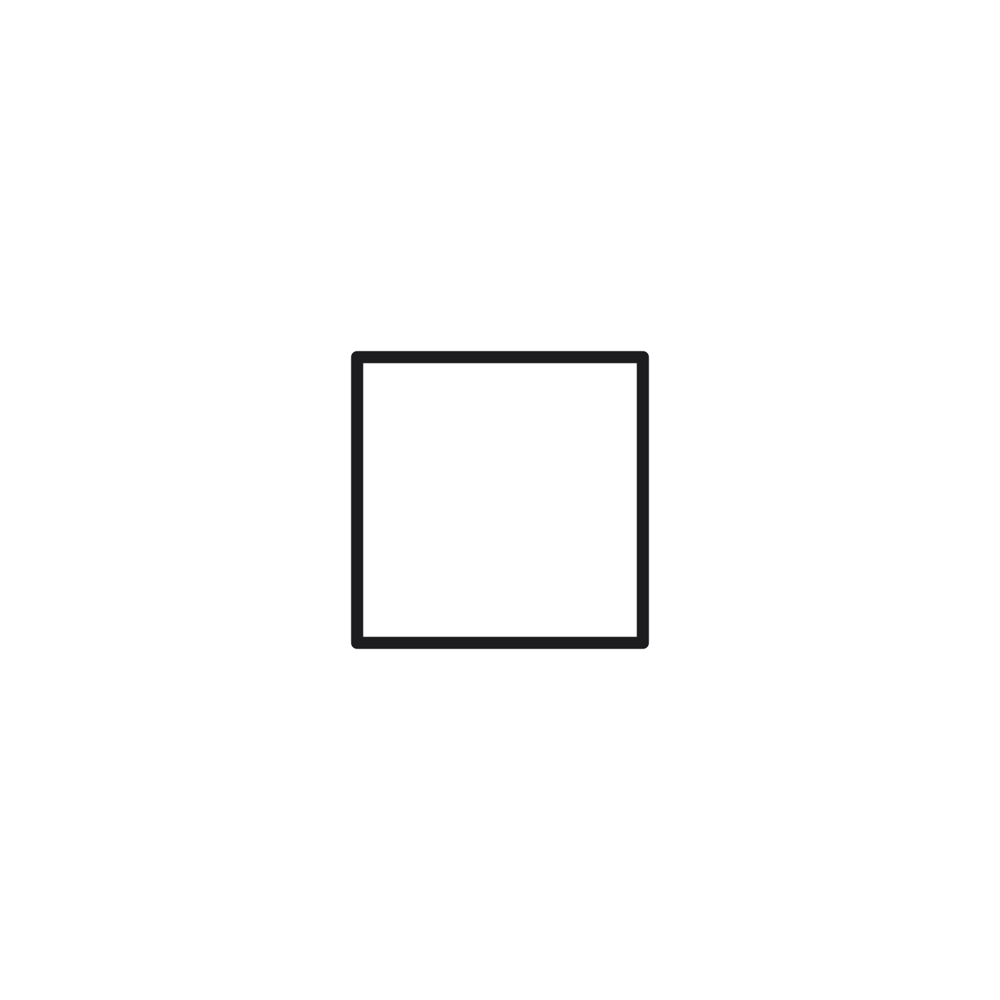
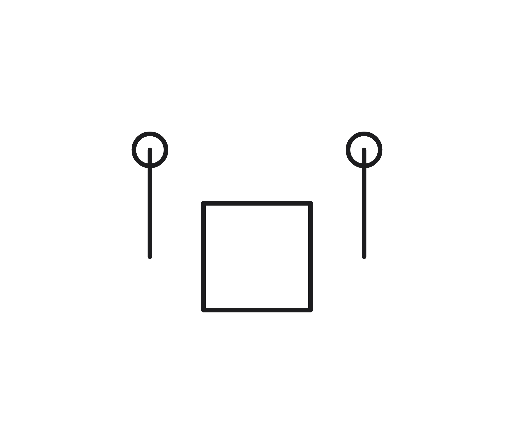

# Writing selected pin roles

In a 0.4 drawing, a rule may select a symbol pin and use it to fill a definition's role. The generated record must retain that pin's identity when it writes the usage explicitly. Otherwise the solver can keep its facts in memory while the saved drawing omits the usage's positions and wires.

Selected pins now use their local symbol name when available. An unnamed pin may use a terminal only when that terminal identifies this exact pin; an earlier shadowed pin cannot borrow a later pin's terminal. Unreferable pins remain reported as unsolved. Released input versions retain their existing output.

The synthetic example below attaches a point and short wire to each selected pin. After saving, both markers and wires remain, and the placement facts hold when reopened.

| Before | After |
| --- | --- |
|  |  |

```spice
* Selected pin writeback
* @RNL(type="header") { @VERSION("0.4") }
R1 a b 1k
* @RNL {
* $S = @DEFINE-SYMBOL { (-1,-1) (1,1) @RECTANGLE; %left=(-2,0) @PIN(terminal=1); %right=(2,0) @PIN(terminal=2) };
* $D = @DEFINE(roles=[["p","pin"]]) { %q=(_,_); %q @CIRCLE(radius=0.3); {?p %q} @ALIGN("x"); ?p %q @DISTANCE("bottom-to-top",min=2); ?p::net @WIRE {?p %q} };
* #R1 @SET-SYMBOL $S => @PLACE(0,0);
* #R1 @SELECT-PIN(wired=false) => @AS $D
* }
.end
```

Generate each drawing with `rnl solve --no-std --solver-options 'budget=candidates:16;time_limit=none' -o solved example.sp`, then render `solved/example.sp`.
