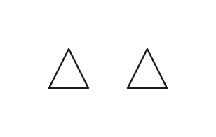

# Solver settings and replay in 0.4

The 0.4 solver defaults to a ten-second shared budget. Fact resolution, model expansion,
structure analysis, candidate search, coordinate pivots and routing consume weighted work.
The report gives the work actually admitted, the stopping reason and a replay command.
Released input versions retain their existing solver behavior during development.

```sh
rnl solver-defaults
rnl solve circuit.sp -o solved --solver-config 'limit="time",seconds=10' --progress
rnl solve circuit.sp -o replay --solver-config 'limit="work",work=243750'
```

Use the reported count for the same drawing level, input, settings and solver build. For a
file with several levels, replay each level with `--level` and that level's own count. Keep
`--report` the same: requesting additional conflict explanations consumes budget too.
Progress goes to standard error and does not enter the saved file. Profiling or progress
observation can move a time cutoff; neither consumes deterministic work.

Time is checked before admitting a positive-cost operation. The reported count is the sum
of admitted operations. A work replay refuses the same next operation, including inside
resolution or a coordinate search. Stopping is latched. Already proved facts remain valid;
unfinished checks are undecided, with warnings, rather than contradictory or satisfied.
Necessary result assembly and forced route completion are deterministic finalization.

The seconds limit applies to each drawing level's solver, not the whole CLI process.
Package loading and interpretation, re-reading between levels, record validation and
writeback happen outside that budget. A ten-second search can therefore take longer
end to end. Compare the level's solver time with the CLI/process time when diagnosing
an overrun; profiling can itself slow search and move a time cutoff. Replaying the
reported work is the way to inspect the same search trajectory.

`SolveReport.canonical_options` is the options text to pass to `sig2` when saving a 0.4
result. It normalizes the time limit to the admitted work, so replay preserves the record's
hash as well as its placements and wires. A caller must not hash its original time settings
in place of this returned text. The CLI uses the returned text automatically.

Deterministic modes also have an emergency wall-clock ceiling, `safety_seconds=30` by default. A
`Safety` stop explicitly reports that the requested deterministic work run was interrupted.
It is not a successful completion of the requested work budget. The solver uses only the
caller's clock, including in WebAssembly; it does not read environment switches or spawn
worker threads.

At a zero-second limit, the old 0.4 resolution-only deadline still allowed placement to run.
The shared zero-second limit admits no model work: the facts remain undecided and the two
symbols stay at their initial coincident positions. This boundary example demonstrates the
scope of the limit; it is not the default ten-second setting.

| Previous resolution-only limit | Shared solve limit |
| --- | --- |
|  |  |

`limit="seed"` finishes the selected layout's initial heuristic pass without later
refinement. Rows, group trees and line layouts use the same shared budget. This mode
does not introduce randomized ordering.

## Settings

`--solver-config` takes the named parameters inside SOLVER-CONFIG parentheses, including
quoted strings and flat arrays. Repeated flags merge by key. Precedence is solver defaults,
package headers in package order, the file header, the level's records, then explicit tool
settings. Defaults do not mask file values. `--solver-options` remains a deprecated alias;
its previous semicolon syntax is also accepted during the transition.

| Key | Value | Default | Allowed in a file |
| --- | --- | --- | --- |
| `layout` | `"rows"`, `"tree"`, `"lines"` | `"lines"` for a 0.4 level; a level of an earlier version is always laid out in rows | yes |
| `spacing_x`, `spacing_y` | integer from -1 through 20; the line layout spaces by them | 0 | yes |
| `junction` | definition name as a string; empty disables dots | unset | yes |
| `tolerance` | finite nonnegative number | 0.000001 | yes |
| `grid` | positive number, or `false` | 1 | yes |
| `beam` | integer from 1 through 1024 | 4 | yes |
| `objectives` | layered objectives as a string | existing layered objectives | yes |
| `limit` | `"time"`, `"work"`, or `"seed"` (initial heuristic candidates only) | `"time"` | no |
| `seconds` | finite nonnegative number | 10 | no |
| `work` | exact nonnegative integer count | required for work mode | no |
| `safety_seconds` | finite nonnegative number | 30 | no |
| `candidates`, `astar_expansions` | nonnegative integer caps | 256, 200000 | no |

The line layout spaces by a nonzero spacing. Under the row and the group-tree layouts it is
parsed and hashed, with a warning that they keep their fixed gaps.

Run settings in a file warn and are ignored. Unknown keys warn and are ignored. Invalid
known file values warn and leave the value before them in place, or the default; invalid tool
values are rejected before solving. The problem hash includes every file value of a key. Junction names are
resolved by the runtime in the target level, including tool overrides, so an override
retains the same name and alias rules as a file setting. Tool overrides enter the options
digest, while the input digest retains the original file settings. A saved result therefore
remains solved when reopened without the command-line overrides. `JunctionConfig.effective()`
selects the resolved tool value for writing; its base definition still identifies the file.

A key's values are checked one by one, not merged first: the runtime gives every value of a
key in the order above, and the solver takes the last one it accepts. A refused value warns,
naming the value that stands instead, the one before it or the default, and the other keys of
the same `SOLVER-CONFIG` still apply. A level's `grid="x"` over a package's `grid=2` therefore
gives `grid=2` and a warning.

`rnl solve FILE --check` checks the settings without solving or writing anything. For each
level it prints every setting in effect and where it comes from (`default`,
`package:NAME`, `header`, `level`, `command-line`), with `file:line` for a setting written in a
package, the header or a level, then the warnings and the errors. Without
FILE, it checks the command line's settings alone. It reports every problem, not only the
first, each with its key. `--json` prints
`{"ok", "levels": [{"title", "settings": {KEY: {"value", "from", "at"}}, "warnings": [{"key", "message"}], "errors": [...]}]}`;
without FILE, `levels` has one entry whose `title` is `null`, and a problem that is not about
one key has the `key` `null`. It exits with 1 when a level has an error, and with 2 when the
command line itself is wrong. `rnl_cli::solve::check_settings` gives the same result to a
viewer.

## Work units and checks

Weights are integers, multiplied by at least one input unit per checkpoint:

| Operation | Weight | Size multiplier |
| --- | --- | --- |
| Resolution/model encoding | 8 | objects, model reconstruction size, or one encoded pair |
| Simplex pivot | 16 | variables × tableau rows |
| Candidate estimate | 32 | elements |
| Placement | 32 | objects |
| Routing | 1 | A* expansion, grid cells, per-tree anchor pairs, or route count at a candidate boundary |
| Structure | 4 | group members or graph edges visited |

The units are a replay protocol, not a promise that every unit takes the same time. Exact
rational arithmetic and input shape affect cost. Changing the checkpoint sequence or
weights requires re-calibration and work counts from the new solver build.

The public `solver_parity` example supplies two synthetic circuits. Initial native debug
calibration ran each three times; all eight runs per repetition finished below 0.012 seconds.
With a requested million units, the two examples admitted 243750 and 997848 units; with
4096 units, they admitted 4056 and 3032. A partly affordable operation is not admitted, so
the count can be below the requested limit. These small examples calibrate the accounting
and replay checks; they do not establish a runtime bound for arbitrary circuits.

Tests cover time-to-work replay at internal cutoffs, kept facts with orientation lists and
local pins, tolerance-dependent coordinates, interrupted Cartesian TABLE expansion,
nested scopes, panic restoration, thread isolation, settings precedence and full saved-file
identity. CI also builds the same example for native and WebAssembly and compares eight
complete generated records byte for byte:

```sh
cargo build -p rnl-runtime-wasm --example solver_parity
cargo build -p rnl-runtime-wasm --example solver_parity --target wasm32-unknown-unknown
node bindings/runtime-wasm/tests/solver-equality.mjs target/debug/examples/solver_parity target/wasm32-unknown-unknown/debug/examples/solver_parity.wasm
```
