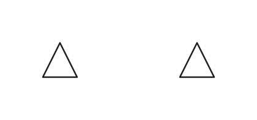
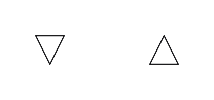

# Declared current direction in 0.4

The solver uses `CURRENT` declarations to prefer orientations with incoming pins facing up and outgoing pins facing down. This works without supply or ground symbols and does not depend on a symbol's name or device kind. Geometric facts take precedence over this preference.

In this small example, two instances use the same custom triangular symbol. The left instance has an outgoing pin and the right one has an incoming pin. Before the solver consumed the declarations, both symbols stayed upright. With the declarations applied, the left symbol turns through 180 degrees; the right one stays upright.

| Before | After |
| --- | --- |
|  |  |

These images illustrate the 0.4 behavior. Released input versions keep their existing layout rules until the language version switch.
