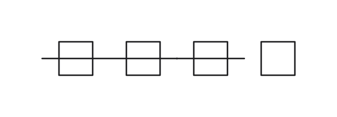
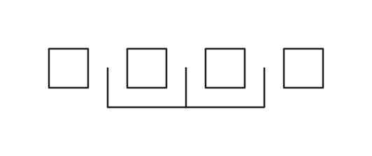

# Group-tree layout

A 0.4 level can select `@SOLVER-CONFIG(layout="tree")`, or a caller can pass
`--solver-config 'layout="tree"'`. The default is the [line layout](solver-lines.md).
The tree engine arranges whole groups in nested rows and columns, aligns adjacent
pins, routes each candidate, then searches list edits, turns and mirrors. It can
bind straight pin pairs and release a recent binding when the search stalls.

These images use the same small synthetic circuit, an explicit area objective,
and a shared work limit. They compare the previous row engine with the tree engine;
they are not a time or quality benchmark.

## Groups and facts

The runtime exports every active group. It supplies three pieces of provenance:
`identity` identifies repeated declarations on the same set, `first` says whether
this is its first valid declaration (including disabled declarations), and `direct`
says whether it was written outside a definition expansion. Failed expansions do
not occupy the first-declaration position. These fields are exported and hashed
for 0.4 only; labels do not decide group precedence.

The solver considers direct declarations before expanded declarations, later first
within each class. Equal member sets reuse the selected group; crossing sets are
omitted. Selection uses the complete member set, including ports, before the tree
projects it onto elements. The selected groups also define the scoring scopes.

Orientation alternatives are search preferences. Search can turn a related class or
choose another authored alternative, but the placement resolver always retains the
original predicates and all kept facts. ALIGN uses its single authored axis. An incompatible batch of alternatives is
rejected as a whole. Exact placement admits list spacing, pin alignment and overlap
repair only below the facts. Main's pin identities, nested tables and text geometry
remain in use.

## Search, scoring and replay

The shared time/work budget reaches tree construction, candidate enumeration,
placement, routing and refinement. Every optional admitted checkpoint costs positive
work. An interrupted operation returns a placement satisfying the kept facts.
Use the reported work amount and the same effective settings to replay a time run.
Work amounts belong to a particular solver revision.

A list containing one item has the same canonical identity as that item. Such a
wrapper adds no ordering, so repeated wrapping cannot improve a tied score or
keep greedy refinement running indefinitely when all objectives are disabled.

`limit="seed"` keeps the layout-specific initial pass: tree search includes its
greedy refinement and bindings; rows skip their additional increasing-radius search.
Under a time or work limit, rows also explore changes beyond the initial beam,
trying troubled objects first and restarting after an improvement.

Initial rows combine current depth with retained, explicitly directed vertical
ORDER, DISTRIBUTE and nonnegative DISTANCE facts. Free ports keep their attachment
orientation; ports touched by facts try the available horizontal directions.
Supply and ground preferences respect their host pins, and row extents include
pin-attached text using the runtime's geometry.

Absolute PIN-ORIENT constraints expose equivalent orientation alternatives to search,
while the original pin predicates remain authoritative. Rows also repair overlaps
between a port's text and neighboring symbols, below all retained facts.

If the shared budget expires while evaluating a challenger, it cannot replace a
completed candidate. This also applies to rerouting and straightening rounds.
When even the first candidate is interrupted, the solver retains its existing
feasible fallback. Work spent on a rejected challenger is still counted for replay.

The configurable drawing objectives include `overlaps`, `crowding`, `misleading`
and `wire_over_symbol`. For 0.4, only configured objectives rank candidates; the
released versions retain their fixed ordering before the objective layers. Default
layout and objective changes are a separate migration step. Global and group spacing
settings are reserved for the subsequent skeleton and line layouts; rows and trees
keep their existing gaps.

The tree engine has no stage, debug, screening or planned-wire switches. It uses the
full tree search with three straightening rounds and up to three binding releases.
Port attachment follows pin bindings and connectivity, including netlist connections
when nothing drawn reaches a port, without inspecting definition or device names.
