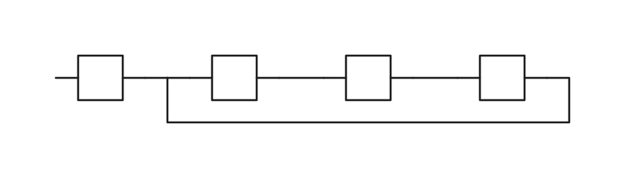
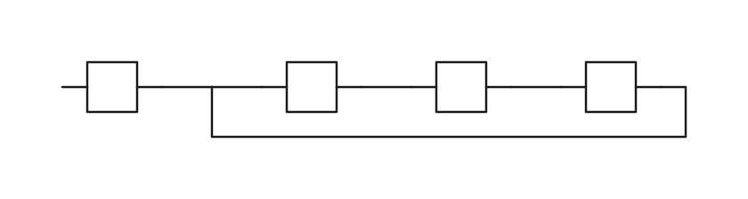
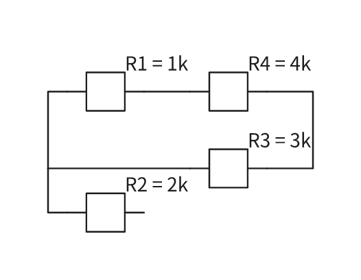

# Line layout

The line layout is the default for an RNL 0.4 level. A file can ask for another with `@SOLVER-CONFIG(layout="rows")` or `layout="tree"`, and callers can select one through the solver options. Levels of earlier versions are laid out in rows, whatever is asked. The linked library, `rnl solve`, and the independent solver use the same engine.

| Group-tree layout | Line layout |
| --- | --- |
|  |  |

This synthetic example has four two-pin symbols in two groups, with three routed nets. Both runs use the seed pass and the same drawing objectives. The line layout moves the branch farther from a pin, increasing clearance and the drawing's width. This illustrates a routing tradeoff, not a time benchmark.

The engine first builds group tables, then settles groups from the inside out, routes on ordered lines, and compacts the drawing while retaining the resolved facts. It compares the completed result with the tree layout under the line-layout order, by which its search and the group tree it starts from rank too: the facts broken, the false joins and the low-priority facts broken first, then the parts not routed and the annotations, the configured objectives, then the layers of the setting `lines_order`. The two drawings are measured outside the level's budget, which the search may have used up. The weights of a crossing and of a bend are the setting `lines_weights`, `[1, 4]` by default: two whole numbers from 0 to 1000, not both 0, which the track router uses too. Only their ratio matters. The canonical options name them only when they are not the default, as `lines_weights=[c,b]`. A preferred result can therefore have a larger area.

`lines_order` sets the layers after the configured objectives, as `objectives` writes layers: separated by commas, the items of a layer joined by `+`, a weight as `name*2`. A layer takes no tolerance, as the search sorts its drawings by this order. The items are `current` (pins whose wire leaves other than along their CURRENT), `crossings_and_bends` (weighed by `lines_weights`), `hidden_ports` (ports whose way out a symbol or another net's wire shuts in), `rail_heights` (the heights of the grounds and of the supplies beyond the first), `mirror_pairs` (pairs bound by a mirrored orientation off the axis they share), `dots_near_pins` (junction dots less than two from a pin of their net), `length`, `wire_lines` (the lines the wires and the ways out of the pins take), `symbol_lines` (the rows and columns of the symbols' origins) and `area`. An item left out does not rank; `none` ranks by none. The default is `current,crossings_and_bends,symbol_lines+wire_lines*2,length,area`: the hidden ports, the heights of the grounds and supplies, the mirror pairs and the dots near pins do not rank, and alignment is one layer before the length, a line of the wires counting two and a row or column of the symbols one. In `symbol_lines` a row or column that only virtual symbols take counts `virtual_weight`, 0.5 by default: the objects of usages, such as supply, ground or port symbols, whatever joins them; one an instance of the netlist or a bundle takes counts 1. The canonical options name `lines_order` and `virtual_weight` only when they are not the default. Failed compaction or exhausted search falls back to a completed candidate. Group spacing uses the main runtime's nesting and explicit-zero rules. Final port cleanup checks the original indexed facts, including complete orientation lists.

The track router joins the parts of a net one at a time, each by the cheapest way it finds then, and does not go back to one it has joined. With `reroute_nets=true` it does once: after a net routed in three parts or more is joined, each of its wires is taken out in turn and the parts it joined are joined again as before, and the net keeps the wires routed again where its own drawing then has fewer crossings and bends, weighed by `lines_weights`, a pin a wire leaves other than by its way out counting a bend, or as many and is shorter. A net whose first wire took the lane a later one needed, as a label beside a pin can make it, is then drawn as a T. It is off by default, as it takes longer: each point its searches expand counts 9,000 units of work, the comparisons with it, since the first routing is paid for in the compaction each drawing goes on to and this is on top of it. The canonical options name it only when it is on.

Compaction keeps the drawing's wires as they were routed but for one change. Where a wire leaves a branch of three, turns and turns back the same way, so that the branch and the bend are the ends of the floor of a U whose two arms run on to bends, the floor may close up: the two arms then lie on one line, the shorter one's bend becomes the branch and the longer arm runs on from it, and the third wire of the branch runs on to it, bent where the branch was. The net is drawn as a T, one bend fewer. A floor whose arm ends at a pin or at another branch keeps its length.

Standalone solver 0.4.8 restores the text clearance at each end of a run to one tenth of the text size. The margin follows the renderer's glyph direction through rotation, reflection and fixed rotation. The full rendered text bounds remain enclosed. This prevents a change of text layout rules from silently removing the spacing used for placement and routing; it can change line choices and the resulting drawing.

This [synthetic example](text-clearance.sp) uses line layout, the seed pass and a 0.1 grid. Restoring the margin moves the right-hand column and wire slightly farther from the text.

| Without run-end clearance | With run-end clearance |
| --- | --- |
|  |  |

An intermediate line arrangement may establish the required order before it satisfies an equality spanning several groups. Strict compaction retains such fixed bounds as mandatory constraints and solves them before accepting the candidate. Disjunctive facts still require a satisfied branch, which compaction retains. A failed or interrupted repair is rejected; completed coordinates are checked against every selected retained fact before ranking.

On each axis the line placement's order treats the units an equality joins, such as the members of an ALIGN, as one class: the class takes one place and each member sits at its offset from it, so they move as one. The least places are those the equalities would give as a bound each way. A bound between members of one class holds by their offsets or leaves the order without places, as do equalities that contradict one another. Bounds are relaxed between classes, not members, so an order counts fewer relaxations against the work budget than before.

Time and work limits cover the same sequence of positive-cost checkpoints. A wall clock is read for the time and safety limits once per 1,000,000 units of work, and at each 256th checkpoint at the latest, since reading it at every checkpoint took several percent of a solve; a time limit can therefore run slightly over. The stop is still at a checkpoint, and the work reported replays it. Standalone solver 0.4.6 gives initial tree refinement a fixed operation-cost estimate of 5,000,000,000 units. A reported coordinate pivot costs `4,754 + 157 × n` units and an A* expansion costs `114`, where `n` counts every object in the level problem; arithmetic saturates at 64 bits. Semantic objects without a drawing still contribute to the coordinate problem and are included. Adding drawing metadata to an existing object does not count it twice. Initialization contributes to the estimate but is completed under the shared budget before optional refinement can stop. The estimate is checked before trying another tree arrangement. The shared time/work budget still interrupts the interior of an arrangement, and line search uses what remains.

These are fixed scheduling weights, not a wall-clock deadline or a promise of five elapsed seconds. The allowance is fixed before refinement starts, without reading the clock: three tenths of the level's limit, in the estimate for a limit of time and in work for a limit of work, and never past the five-second estimate. The line search therefore has the rest of the budget at any limit. The solve reports the work at which refinement stopped as `tree_work`, which a replay by work gives with its work ([solver settings and replay](solver-budgets.md)). This replaces the preceding refinement allowance based on raw tableau-sized work, which could allocate different shares merely because a problem encoded more constraints. Tree and line stages keep their own completed results; exhausting the tree estimate does not exhaust the whole solve. The estimate and its coefficients are part of the replay policy, so replay requires the same solver build.

The line search ends before the budget does once it has made as many complete solutions in a row without a better one as it had made when it found its best, and at least 200. A best found late is waited for longer. Without this end, the search went on until every spread of every choice's gaps was tried, which on a small level is thousands of placements, each wider than the last, and used the whole budget. It counts solutions, not time, so a run replays alike by its work. Such a level's budget reports `Complete`, as one whose search was exhausted does, and the search's note ends with `ended after N complete solutions in a row made none better`.

The line search does not rank its drawings by the wires that their compaction could not keep their whole gap from a symbol, a pin or a text. It used to rank such a drawing after every drawing without them, before its crossings and bends, so a drawing that routing again would have made the best could lose to any other. In a bandgap reference whose op-amp sat between two branches, every drawing with the op-amp's output up had a wire too near a supply stub once compacted; the search never took one and drew the gate net and an input net as an X instead, 3 crossings and 7 bends against the output-up drawing's 0 and 7. The drawing the search takes is routed again until its wires keep their gaps, in two more rounds at most: the first keeps clear the sides of the symbols they were too near, the second every side of every symbol. A drawing whose wires still cannot keep them is not taken, and the level is laid out as the group-tree layout has it. These rounds and the spacing that follows are done whatever the budget left. Once it is spent they run past its limit, as the routing of a drawing whose nets the budget left unrouted does: only the safety limit of a limit of work stops them (a limit of time has none, and their own bounds on routing and compaction bound them there), and their work is left out of the work reported, so that a replay by that work does them alike. A round or a spacing the limit cut is done again past it, and the note says how much work they took. A level can therefore run a little past its seconds. On the bandgap reference above, when the time stopped its search, the second round took about 2.2 billion units of work past the limit and the level ended some 0.06 s after its seconds, where a level stopped by the time otherwise ends some 0.01 s after them. How far past the limit they can go depends on the level, its nets and symbols, through the bounds of routing and compaction, such as `astar_expansions`; with the default `spacing` of 0 the spacing does nothing. Only when the safety limit stops a later round is the drawing of the round before taken with the wires that do not keep their gaps, the note saying how many. The spacing's drawing is still not taken when it was interrupted or would worsen the annotations' clearance. The group-tree layout a level falls back to is not spaced once the budget is spent, as before.

Standalone solver 0.4.2 omits zero-distance auxiliary rows for isolated origin coordinates already at their target. It retains their exact optimum with direct bounds for the objective layer; the normal layer rollback before grid rounding removes these bounds as before. Coordinates coupled to existing rows, relative targets, or repeated origin targets keep the full objective. This reduces constraint-processing work without changing the lexicographic objective; replay still requires the same build.

The first tree candidate is initialized under the shared budget. If initialization already used the estimate, refinement is skipped. This prevents a small stage estimate from turning an otherwise feasible initial route into forced wires. The global time or work limit still interrupts initialization.

Seed and unlimited modes retain their own stage behavior and canonical settings. Time and work results persist the admitted work count as their canonical limit. A safety timeout remains explicitly non-reproducible.

Orientation enumeration checks the shared budget before measuring each choice. Combination counts and route-window areas use fixed-width arithmetic on native and WebAssembly builds. In line-search tie breaking, a single-item list has the same canonical identity as its item: adding empty layers of row or column wrapping cannot count as an improvement or keep the seed search running indefinitely.

Routing-window preparation also consumes the shared budget while filling obstacle and clearance masks. An interrupted window is discarded before routing uses it, preserving the last completed candidate.

Crossing measurements consume the same budget during rerouting and final route scoring. A cutoff during those scans rejects the unfinished route rather than treating its partial crossing count as a completed score.

Auto wires with effective 0.4 source semantics call the runtime's shared default path (13.1), including whole waypoint chains and generated content. Unobstructed, unmerged two-anchor auto routes use that same path: bends first, then length, with the runtime's tie order. Existing wires and obstacles prevent that substitution. Compaction and port cleanup recheck the default at the final coordinates before reporting its score and skeleton. This new core rule can change pictures and scores compared with the experimental solver.

Standalone solver 0.4.7 applies this substitution only when every endpoint of the route is present. Two pins visible inside a child group may be part of a larger routing tree; its temporary path stays available for joins in the parent group. Complete two-anchor routes still use the shared default inside a group, including when multiple references name the same physical pin.

Writeback materializes the chosen path and junctions even after search stops; this is deterministic output conversion, not further layout search. Unevaluable written geometry is fatal and cannot replace an existing record. Independent routing trees remain independent despite matching net names or coordinates. A shared real anchor combines directions only at that identity, and a pin-position reference never acquires an electrical pin lead.

`SolveReport.skeleton` describes the final group tables and line identities. The independent solver sends it from protocol version 5 on. After port cleanup changes geometry, the description is refreshed from the final coordinates. Visible interface details use the main runtime's symbol, column-text, baseline, and position models.

Materialized annotations remain obstacles during routing and compaction. Their bounds are recomputed after coordinate changes, including text that depends on its anchor. Completed candidates, spacing and port cleanup retain the previous drawing if annotation clearance worsens. Unevaluable annotations retain the runtime's fatal reporting and cannot be written back. Existing junctions are reused by point identity, including physical pin aliases; coordinate coincidence alone does not reuse a junction.

Orientation lists retain only the group's class and open-way values. Search deduplication uses two domain-separated 64-bit fingerprints of exact geometry, with a fixed-width encoding shared by native and WebAssembly. Fingerprints affect candidate membership, never ordering or hard-fact validation; a collision can skip a candidate.

Each enumerated list holds at most 200,000 combinations. All live enumerated lists together hold at most 800,000, including lists still retained by a search core after cache eviction. Conservative, architecture-independent storage accounting further limits one list to 64 MiB and live lists to 256 MiB. These are limits for combination storage, not a process-wide memory guarantee. Reaching a storage limit marks the list incomplete and preserves its admitted prefix.

Every orientation trial pays its size-dependent listing cost before allocating geometry, through the same checkpoint in time and work modes. Interrupted listing therefore counts as work, and replay stops before the same trial. Output materialization runs after the search limit; profiling reports auto-default refresh, branch attachment, and materialization separately from search.

Standalone solver 0.4.3 propagates coordinate equalities between retained DISTRIBUTEs sharing the same endpoints. Members at the same fractional position align, including reversed spans and different subdivision counts. These consequences guide an inner group even when the span endpoints belong to its parent; they do not add or weaken authored facts. Coordinate aliases and singleton sets use their modeled identity, and inference storage grows linearly with input members. Positive inequalities inside an already merged coordinate class are reported as conflicts immediately instead of consuming the relaxation limit. Both changes use the shared work budget, so work counts require the same solver build for replay.

Standalone solver 0.4.4 preserves structural line-merge hints from semantic usages that have a coordinate object but no symbol. Nested roles naming these objects expand to their members; a virtual part drawn with a symbol remains a single object. This restores the same role-based hints without consulting definition names or adding constraints. The traversal uses the shared work budget, and legacy usage handling stays unchanged.

Standalone solver 0.4.5 uses the same electrical pin identity for terminal and physical symbol-pin references when estimating bends to order orientation candidates. A coordinate-only reference to a pin remains a position and supplies no electrical endpoint. The estimate and its tie order are otherwise unchanged; work replay requires the same build.

## Cost calibration

Local orientation filters inspect the actual candidate after applying authored `ORIENT` and `ORIENT-RELATION` alternatives. This includes choices that have no free orientation class. Same-symbol `ALIGN`, directed `ORDER`, and directed `DISTRIBUTE` constraints therefore filter invalid directions before routing and compaction. These checks use the shared work budget and are part of standalone solver 0.4.2's replay policy.

Standalone solver 0.4.0 introduced the following fixed line-search coefficients, retained in 0.4.1. They supplement the shared model, pivot, structure and routing checkpoints; work units are a replay protocol, not elapsed nanoseconds.

| Operation | Fitted cost coefficient (ns) |
| --- | ---: |
| Choice | 12,434 |
| Relaxation | 102 |
| Route | 7,907 × objects |
| A* expansion | 217 |
| Merge | 378,800 |
| Merge pivot row | 180 |
| Merge relaxation | 102 |
| Listing trial | 2,908 × objects |

Calibration used the optimized Windows x64 build from [this source](https://github.com/rich-netlist/rnl/commit/edff9a1cadba40f6c7693eacba38b19063ab6378), on an Intel Core i7-12700KF. The process ran at normal priority on one logical CPU. Four- and eight-symbol shared-net groups, a two-symbol link, a four-symbol fan and eight fixed symbols were each run twice in seed mode. Groups of sixteen and thirty-two symbols were each run twice with a ten-second limit. All fourteen unprofiled repeats or work replays reproduced the saved files byte for byte.

The fit used 7,582 completed spans: 6,574 choices, 497 routes, 497 merges and fourteen settling spans. Child route time was removed from choices; direct choice, merge and weighing time was removed from settling. Nonnegative least squares with relative residuals and a soft-L1 loss (scale 0.2) estimated the coefficients; relaxation and merge relaxation share one coefficient. The route intercept fitted to zero. Coefficients were rounded to integer nanoseconds. Median relative residual was 5.8% overall, 12.3% for routing, 11.0% for merging and 36.2% for settling. Profiling overhead and variation between input shapes remain part of these approximate estimates.

Six control runs of the preceding optimized build bracketed the measurements. Their median line time differed by -4.5% from the earlier control, within the preselected 15% drift limit; all controls were retained. The timed synthetic solves took 10.006–10.032 seconds inside the solver and at most 10.266 seconds as a process; their unprofiled work replays took 7.53–9.25 seconds as a process. These observations validate those inputs, not a universal ten-second bound.

The line tally converts each coefficient to thousandths of a work unit with `floor(ns × 1000 / 1050)` and carries fractional totals between charges. Listing is admitted before each trial: for `n = max(1, objects)`, its checkpoint costs `4 × n + ceil(2769 × n / 1000)` units, including the existing structure cost. Tests pin the coefficients and the atomic admission boundary. Recalibrating this policy requires work counts from the new solver build.
