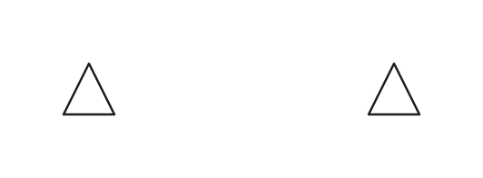
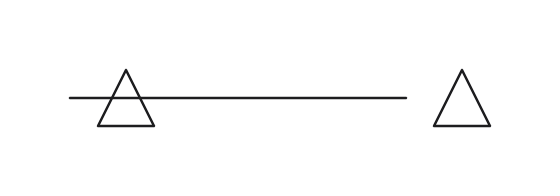

# Bounded routing in 0.4

Each route-tree entry is routed separately, even when several trees belong to the same electrical net. The router can reorder blocked trees and try them again. It prefers paths around symbols and text, treating text as a soft obstacle and a lead along its own symbol as a last resort.

If the search exhausts its budget or cannot find a path, the remaining parts are connected by a direct orthogonal path. The solve report counts these forced connections; the ordinary geometry scores still count any crossed symbols or other obstacles. Exhausting the search budget therefore does not leave a requested tree disconnected.

The following comparison uses a zero search budget. Before, the two symbols were left without a wire. After, the requested connection is present and reported as forced. It crosses a symbol because the search had no budget to find a path around it. The symbol positions are unchanged; the drawing bounds include the added wire.

| Before | After |
| --- | --- |
|  |  |

Junctions follow electrical pin identity, not just coordinates: a pin's `position` point does not connect to the pin. Dots are written only through the configured junction definition. Released input versions retain their existing routing behavior until the language version switch.
