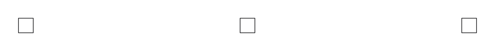
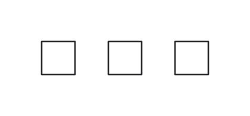

# Skeleton layout experiment

The independent solver offers an opt-in `skeleton` command for RNL 0.4 inputs:

```sh
rnl problem --solver-input --solver-config 'limit="work",work=200000' circuit.sp > input.json
rnl-solver skeleton --rounds 1 input.json > result.json
```

It starts with a grouping-tree drawing, compacts the drawing's line identities, and preserves all retained facts, including authored placements. The initial compaction is taken even when it worsens a configured score. Optional rounds reroute and compact again, keeping only improvements; these comparisons ignore layers consisting solely of component alignment. The final report still uses the complete configured score.

Independent routing trees keep their identities even when they share an electrical pin. Coordinate-only pin positions remain separate. The compaction constraints also retain nested definition offsets and the geometry of text attached to symbols. Group spacing uses the innermost accepted group containing both features; an explicit zero overrides outer spacing.

`--rounds` accepts 0 through 3 and defaults to 0. All phases share one time or work budget. If it expires before compaction, the verified tree drawing is retained and the report says that compaction did not run. Interrupted compaction retains the constraints already proved. There is no extra unmetered finishing phase.

The command returns the ordinary versioned solver result. Its canonical settings include an `experimental=skeleton:N` suffix so its persisted hash distinguishes it from a normal solve. For replay, keep the same command and round count, and replace the input's time limit with the reported consumed work.

The normal `rnl solve` path and SOLVER-CONFIG do not expose this experimental layout. Explicit external invocation is available:

```sh
rnl solve --external-solver rnl-solver --external-arg skeleton \
  --external-arg --rounds --external-arg 1 -o solved circuit.sp
```

## Inspecting an authored drawing

```sh
rnl-solver compact-drawn input.json > preview.json
```

This command first resolves the drawing with its authored coordinates, then releases retained PLACE and PointCoordinate facts only for compaction. Other retained facts remain in force. Its output has `format: "rnl-skeleton-preview"`, version 1, and the input protocol version. Each requested level includes positions, source PLACE locations, explicitly relaxed and preserved fact indices, errors, warnings, notes, budget and replay settings.

The preview contains no ordinary Solution or fact report, and `rnl solve` rejects it as an external solver response. Source locations identify provenance, not edits to apply automatically. If the budget expires before the original drawing is ready, `available` is false and no positions are supplied. A later cutoff can retain an earlier valid compaction. Repeat the same command with the reported work budget to reproduce its JSON bytes.

These synthetic drawings show three aligned symbols before and after the preview.
Their authored x coordinates are 0, 30 and 60; the preview gives 26, 30 and 34,
while preserving their orientations and horizontal alignment. The second image
is rendered from a separate illustration with those returned coordinates; the
preview command itself does not modify the source.



